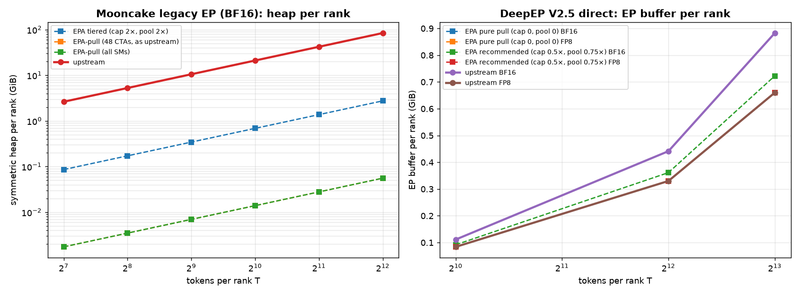
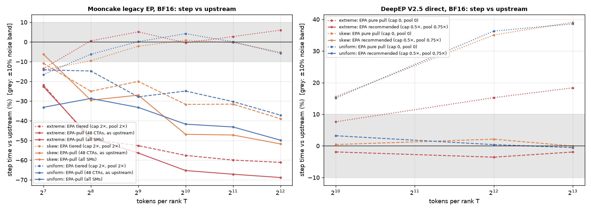

# EPArena: an on-device, VMM-free memory allocator for expert-parallel buffers

Status: implemented and measured on one 8× B300 NVLink node (2026-10-29).
Code: `MOE_libs/epa/` (allocator, micro-benchmarks, library integrations).
Results: `results.md`, `fig_memory.png`, `fig_time.png` in this directory (generated by
`make_results.py` from the JSON in `epa/**/results/`). Patches: `patches/`.

## 1. Problem

Every EP library studied in `MOE_libs` reserves receive memory for the *worst-case*
routing, because three things hold at once:

1. **Routing is data dependent.** How many tokens a rank receives (and for which
   expert) is known only after the router runs on every rank.
2. **Senders place data without coordination.** A sender writes into a slot of the
   receiver that it can compute alone — `[source][token]` (DeepEP V2.5),
   `[expert][source][token]` (Mooncake/DeepEP-V1 low latency), `[expert][token]`
   (Mooncake combine). Each such slot array is sized so that *every* key can hit its
   maximum at the same time, which no routing can actually do.
3. **No host sync, static shapes.** Decode runs under CUDA graphs, so a buffer cannot
   be sized after the counts are known.

How far the reservation is from what is used (R = 8, E = 384, k = 6, H = 7168, BF16,
per rank, T = tokens per rank):

| Library / buffer | Reserved | Used by uniform routing | Ratio |
|---|---|---|---|
| Mooncake legacy dispatch recv `[E/R][R][T]` msgs | 384·T | ≈ 6·T | 64× |
| Mooncake legacy combine recv `[E][T]` slots | 384·T | 6·T | 64× |
| DeepEP V2.5 dispatch recv `[R][T]` tokens | 8·T | ≈ 4.4·T | 1.8× |
| DeepEP V2.5 combine recv `[min(R,k)][T]` | 6·T | ≈ 4.4·T | 1.4× |

(4.4 = R·P(token hits a rank) = 8·(1 − C(336,6)/C(384,6)).)

Mooncake's legacy `Buffer` therefore needs 2.6 GiB at T = 128 and 84 GiB at
T = 4096 (measured heap), almost all of it never written.

The obvious fix — map physical pages on demand behind a worst-case virtual range —
is CUDA VMM, which this design must not use. Without VMM a buffer's bytes must be
physically present, so savings must come from **placing data compactly** and
**guaranteeing a correct path when a compact region is full**.

## 2. Requirements

- **R1 Lossless.** No token may be dropped or trap, for any routing.
- **R2 No host involvement per step.** No sync, no allocation call, CUDA-graph safe.
- **R3 No slowdown** for the routing a model actually produces.
- **R4 Library agnostic.** Work with any symmetric-memory provider (cudaIpc,
  NCCL windows, NVSHMEM, torch symm-mem) and any kernel style (warp copies, TMA).
- **R5 No VMM.** One ordinary allocation per rank.

## 3. Design: a device-side dynamic allocator (`epa::Arena`)

EPArena is a general, VMM-free memory allocator that GPU kernels call directly; EP is
one client. The worst-case buffers of §1 exist because memory had to be decided before
a kernel knew what it would produce. With an allocator inside the kernel, memory is
taken when data appears and given back when it is consumed, so a buffer holds what is
in flight, not what could be.

```
one cudaMalloc per GPU (optionally shared with peers via cudaIpc / NCCL / NVSHMEM)
 └─ N pages of page_bytes
     ├─ free-page ring    lock-free MPMC ticket ring (head/tail tickets + per-slot
     │                    sequence, Vyukov): take n pages = 1 CAS reservation + 1
     │                    fetch-add per warp; give = 1 fetch-add + n slot stores
     ├─ WarpHeap          malloc/free up to a page: a warp owns a page and bumps;
     │                    any thread anywhere frees; refs[page] returns the page when
     │                    its owner retired it and its last object is freed
     └─ PagedArray        growable array of rows: append(n) from any thread on any
                          rank; rows contiguous inside a page, pages via a page table
```

Properties that make it usable inside any kernel:

| | |
|---|---|
| No VMM | contiguity only within a page; larger objects are paged (page tables, like PagedAttention) |
| No host | every operation is a device atomic; CUDA-graph safe; the host only reads stats |
| Multi-GPU | an arena is addressed by base pointer, so a kernel can take pages from a peer's arena over NVLink (system-scope atomics) |
| Contention | one CAS + one fetch-add per warp per take, one fetch-add per give; malloc inside a page needs no atomics |
| Out of memory | a policy at the call site: `try_*` returns failure and the caller keeps data where it is; `wait_*` retries until pages come back |

**Home + Window are usage patterns of the arena.** A Window is a page budget: the
arena's size. The round rule is the `wait` policy (a consumer that frees slots lets
the next round in). The Home fallback is the `try` policy: when no page is free, a row
stays in its producer's memory and is read in place. A ring is take-on-produce,
give-on-consume. Sizing therefore moves from "per buffer, per worst case" to "one
budget for what is in flight", shared by every buffer, phase, layer and library on
the GPU, and a device-side low-water mark tells the host how much of it was needed.

Code: `epa/include/epa/arena.cuh` (header only), tests `epa/tests/test_arena.cu`,
benchmark `epa/bench/bench_arena.cu`, EP instance: Mooncake dispatch with rows in the
receiver's arena (`epa/integrations/mooncake/make_arena_kernels.py`).

### 3.A Home + Window: the fixed-budget form used by the library integrations

EPArena is one mechanism. Every EP buffer in every library studied is an instance of it;
the libraries differ only in *how often* a consumer can recycle its window.

```
Home    producer-owned, symmetric, EXACT   rows a rank produces, indexed by its own
                                           tokens: x [T][H], top-k [T][k], expert
                                           output y, a row-id table. Never worst case.
Window  consumer-owned, BOUNDED            W = β · T · k rows of staging in front of
                                           the consumer (GEMM input, ring, scratch,
                                           receive pool). The only sized thing.
Index   compact receive id r               a row's position in the consumer's
                                           expert-major list: prefix sum of counts
                                           read from peers' top-k, or one fetch-add
                                           per (source, key). Computed on device.
```

**The rule.** Row r is consumed in *round* ⌊r / W⌋ at window slot r mod W. A slot is
refilled only after its previous row was consumed. A row that has not got a slot yet
waits in its producer's Home, so nothing is ever dropped and nothing is sized for
the worst case: the worst case only changes how many rounds run, never memory.

Rounds are bounded (at most ⌈R·T·k / W⌉) and fixed at capture time, so the step stays
CUDA-graph safe; rounds past the actual load are skipped on device. Correctness
never depends on β. β (≈ 1.25–2, above the EPLB-bounded rank imbalance) only decides
how often a second round is paid for.

**Three consumer granularities** — the same rule, different "slot freed" signals:

| Consumer recycles its window… | Freed signal | Overflow cost | Libraries |
|---|---|---|---|
| per row (copy/reduce kernels) | the row is read directly from Home instead of staged | one remote read per overflow row | Mooncake (EPA-pull: W covers the GEMM input, rounds = 1), DeepEP (pool = window, overflow = tier-3 descriptor + pull) |
| per block (persistent fused kernels) | per-slot empty counter (credit) | waits on a slot | DeepGEMM Mega MoE ring (`l1_empty_count`) |
| per launch (grouped GEMMs) | stream order between window launches | one gated launch per extra round | dist_moe scratch windows |

**What a library changes to adopt it** is therefore always the same three edits:
(1) put the producer's tensors in the Home (most libraries already stage there:
Mooncake `zero_copy`, DeepEP-V1 send buffer, Mega MoE and dist_moe symmetric x);
(2) size the window as β · T · k instead of the worst case; (3) give the consumer its
round loop — a slot wait, a gated launch, or a direct Home read for overflow rows.

Device API (`epa/include/epa/epa.cuh`): `PeerTable` (Home addressing on any symmetric
provider), compact index (`warp_reserve` = one fetch-add per key, or a prefix sum),
`slot = r % W`, `round = r / W`, and the overflow case (`TieredSlots::resolve`: in
window, or pull from Home). The sections below are the measured instances.

### 3.0 Instance, per-row consumer with W = whole GEMM input: EPA-pull (Mooncake)

The worst case exists only because a *receive* buffer must exist before the receiver
knows what it will get. EPA-pull removes receive buffers instead of shrinking them.
The allocator's whole job becomes: place every tensor that a peer must read in the
symmetric heap, at the size its *producer* knows exactly.

```
per rank, symmetric (one cudaMalloc + cudaIpc):
  home_x     [T][H]      this rank's tokens, staged once (FP8 cast as upstream)
  home_topk  [T][k]      int32 routing of those tokens
  back       [T][k]      int32 row of (t, k) in the expert rank's y, written by that rank
  y          [E/R][R·T][H]  expert output; the GEMM writes here (zero-copy, like
                         Mooncake's existing `zero_copy` combine mode)
  flags      [2][R], epochs
```

Dispatch (one cooperative kernel):
1. stage x and top-k into home; raise `flag[me]` on every peer (epoch value);
2. wait for all flags; count my entries per (local expert, source) by reading every
   source's top-k over NVLink (k ints per token);
3. prefix → `layout_range`, `packed_recv_count` exactly as upstream (rows of an
   (expert, source) pair contiguous, sources in order);
4. pull rows into `packed_recv_x`, **with work split over (source, token)**, not over
   (expert, source), so a hot expert is spread over the whole GPU; write `src_info`
   and the 4-byte row id back to the source.

Combine (one cooperative kernel):
1. raise `flag[me]` (my y is complete); wait for all flags;
2. per (token, 64-int4 chunk) work item, pull the token's k rows from the expert
   ranks' y and reduce in top-k order — the same arithmetic as upstream.

Why it is simpler *and* faster:

- **Memory is exact by construction.** Every symmetric tensor is indexed by this
  rank's own tokens (`T` rows), never by (key × worst case). 57 MiB at T = 4096 versus
  84 GiB for Mooncake's `BufferPair`. There is nothing to tune.
- **Fewer passes over memory.** Upstream dispatch writes a staging row, pushes it into
  a receive slot, then copies the slot into `packed_recv_x`. EPA-pull reads the staging
  row from the peer straight into `packed_recv_x`. Combine reads expert outputs
  directly instead of pushing them into slots first.
- **Load balance independent of routing.** Upstream gives each (expert, source) pair a
  fixed 4-warp group, so a hot pair serializes. EPA-pull splits work by token, so
  extreme expert skew costs almost nothing.
- **No ping-pong buffers or cleaning protocol.** Device-side epoch flags replace
  Mooncake's double buffering and `next_clean_buffer`. Reuse is safe because a rank
  rewrites home/y only after its next wait on every peer's flag, and every peer raises
  that flag only after it finished pulling.

What it requires from the caller: the expert GEMM writes its output into the heap's
`y` (a tensor view handed out by EPArena). The per-call `packed_recv_x` and `y` have
the same sizes as upstream; only the symmetric communication buffers disappear.

GPU-efficiency details that mattered (measured):
- A combine that maps one warp to one token left ~90 % of warps idle at T = 256 and
  made each lane wait on 28 dependent NVLink round trips (2.9× slower than upstream);
  splitting tokens into 14 chunks with 2·k independent loads per lane made it 1.7×
  *faster* than upstream.
- Pull bandwidth needs bytes in flight: every warp copies with 7 independent 16-B
  loads per lane, and the grid uses all SMs (also measured with upstream's 48 CTAs).

### 3.1 Symmetric heap and phase planner (host, once)

One `cudaMalloc` per rank, exported with `cudaIpcGetMemHandle` and mapped by every
peer (`epa/include/epa/heap.hpp`, `SymmetricHeap`). Libraries that already own a
symmetric allocation (DeepEP's NCCL window) keep it; EPArena only needs a
`PeerTable` that maps a local address to the same offset on a peer.

Inside the heap, `plan_regions()` places named regions given the *phases* in which
each is live, and overlaps regions whose phase sets are disjoint (first-fit by
size over the interference graph — the buffer-assignment heuristic of XLA/TVM). In
the Mooncake integration the phases are the joint states of its two ping-pong
buffers, so each buffer's dispatch region and combine region share bytes while
the two buffers never do. The same planner lets several EP libraries (or
prefill/decode instances of one library) share one heap.

### 3.2 Instance, per-row consumer with a pushed window: tiers (DeepEP, Mooncake-tiered)

Tier 1 + tier 2 are the window (W = cap + pool), tier 3 is the Home read for rows
with r ≥ W.

A library keeps its logical slot index `(key, j)` — the index its sender already
computes with a local atomic — and EPArena decides where the payload goes:

```
tier 1  j < cap                → static slot  slots[key][j]           (pushed, as upstream)
tier 2  j ≥ cap, pool has room → pool row     pool[base_key + j − cap] (pushed)
tier 3  pool full              → stays in the sender's home row;
                                 4-byte descriptor desc[key][j] = row  (receiver pulls)
```

- **Tier 1** costs one compare. With `cap` = the old maximum, the layout degenerates
  to upstream.
- **Tier 2** is a pool shared by all keys of one receiver, which removes the
  per-key worst case: the pool only has to cover the receiver's *total* load,
  whose imbalance is far smaller than per-expert imbalance (measured: 1.78× for a
  Zipf-1.0 expert distribution whose hottest expert gets 40× the mean). A source
  reserves *all* of a key's overflow with **one** relaxed NVLink fetch-add
  (`atomicAdd_system` on the receiver's pool head), issued by the warp that already
  counts tokens per key in upstream code, and tells the receiver the base through a
  per-key table. Sending warps that reach `j ≥ cap` read the base from local memory.
- **Tier 3** makes the scheme lossless with a bounded footprint: the only extra
  memory is a home row per *source* token (`T` rows — DeepEP-V1-style kernels
  already stage every token there) and a 4-byte descriptor per logical slot.
  Descriptors are worst-case sized but 3500× smaller than the payload they replace.

The receiver resolves each logical slot with the same three cases
(`TieredSlots::resolve`). No path waits on the host, so all of it is graph safe.

### 3.3 Exactly keyed layouts (no tiers needed)

Some worst-case layouts are worst-case only because of their key. Mooncake's
combine writes expert e's result for token t to `[e][t]` (384·T slots), but each
token has exactly k results, so keying by top-k position `[k][t]` is exact.
The top-k position travels with the dispatch message (a header int / the
descriptor) and is stored in the handle (`src_info = k << 24 | token`).

### 3.4 Sizing and telemetry

| Parameter | Rule | Why |
|---|---|---|
| `cap` (tier 1) | 0 – 2× the mean per-key load | Lets sends start before the tier-2 base is known; 0 is fine when the base arrives early |
| `pool` (tier 2) | β × mean receiver load, β ≥ worst observed receiver imbalance (≈ 1.25 – 2) | EPLB already bounds rank imbalance |
| home + desc | T rows + 4 B per logical slot | Required for R1 |

The receiver counts tier-2 and tier-3 messages in device memory (`epa_stats`); the
host reads them every N steps without syncing the step and grows `pool` if tier 3
is used regularly (re-planning is a re-allocation at a safe point, not VMM).

## 4. GPU efficiency notes (what the measurements forced)

Micro-benchmarks (`epa/bench/micro.py`, 8× B300):

| Primitive | Cost |
|---|---|
| NVLink fetch-add round trip (dependent) | 1.48 µs (local: 0.14 µs) |
| Fetch-add throughput, 8 hot counters, 1 per lane | 0.47 G/s for the whole node |
| … warp-aggregated | 1.76 G lane-requests/s |
| Push vs pull all-to-all, 132 SMs × 16 warps, 14 KB rows | 616 vs 640 GB/s per GPU |
| Push vs pull, 32 SMs × 8 warps | 547 vs 234 GB/s per GPU |

Consequences:

1. **One remote atomic per (source, key) per call, never per message.** At 0.47 G/s
   per node a per-message reservation would add milliseconds at T = 8192.
2. **Reserve before any sys-scope release.** The first tier-2 version published the
   pool base *after* upstream's `atom.release.sys` on the finish counter. A
   sys-scope release waits for all of the thread's prior writes — and in practice
   the SM's outstanding NVLink stores — so the base appeared only after the whole
   tier-1 send (74 µs instead of 7 µs, traced with `%globaltimer`), and every tier-2
   message waited for it (+110 µs). Reserving and publishing with relaxed
   operations first fixed it: the base orders no data, so relaxed is correct.
3. **Poll politely.** Waiters spin on a `volatile` load with `__nanosleep(32)`; an
   acquire load in a tight loop by many warps floods L2.
4. **Tier 3 is a fallback, not a fast path, in warp-copy kernels.** A pull needs
   ≥ 4× more bytes in flight than a push to reach the same bandwidth. Mooncake's
   receive phase assigns one 4-warp group per (expert, source); when one hot pair
   is pulled, that group is latency bound. DeepEP's epilogue pulls with TMA bulk
   loads, which keep more bytes in flight per thread.

## 5. Integrating a library: one API

Every integration goes through `epa/include/epa/window.cuh` (header only, host +
device, includable from plain C++ host code) or its Python mirror
`epa/python/epa_window.py` (same fields and rule; `epa/tests/test_window.py` checks
927 values agree):

| Call | Meaning |
|---|---|
| `epa::window_rows(β, T, k)` | rows of a window for β × the balanced load |
| `epa::Window{num_keys, keyed, shared, max_rows}` | the bounded staging; `rows()` = physical rows |
| `slot(r)`, `round(r)`, `num_rounds()` | the rule: row r in round r / W at slot r % W |
| `clip(begin, n, rnd)`, `round_counts(counts)` | per-launch consumers: rows of each key in a round |
| `wait_free(freed, r)` | per-block consumers: wait for slot(r)'s release |
| `overflow(n)`, `accept(base, n)`, `warp_reserve(...)` | producers that push: one fetch-add per (warp, destination) |
| `row(key, j, base)` | physical window row, or −1 = read the row in place from Home |
| `epa::Home{pt, base, row_bytes}.row<T>(rank, i)` | a producer's row on any rank |
| `epa::PeerTable` | peer addressing on any symmetric-memory provider |

How each integration uses it:

| | Window | Consumer frees a slot | Home | Where the calls are |
|---|---|---|---|---|
| Mooncake EPA-pull | `packed_recv_x`: keys = E/R experts, keyed = R·T, shared = 0 | per row, one round | `home_x`, `home_topk`, `back`, `y` via `epa::Home` | `integrations/mooncake/epa_pull.cuh` |
| Mooncake tiered | keys = (expert, source), keyed = cap, shared = pool | per row: `row()` = −1 → read from Home | the upstream send buffer | generated by `make_epa_kernels.py` |
| DeepEP V2.5 | keys = source ranks, keyed = cap, shared = pool | per row: `row()` = nullptr → read from Home | new `[T]` region, TMA-stored once | `deep_ep/include/deep_ep/layout/ep/epa.cuh` (`EPALayout::win`) |
| DeepGEMM Mega MoE | the L1/L2 ring: shared = live blocks of `window_rows(β, T, k)` | per block: `l1_empty_count` (the kernel's own `wait_free`) | each rank's symmetric x | `csrc/apis/mega_moe.hpp` (host sizer only) |
| dist_moe | expert scratch: shared = rows at β, max_rows = rows at F | per launch: `num_rounds()` gated launches over `round_counts()` | each rank's dispatch buffer | `dist_moe/api.py` (`_epa_window`) |

The DeepEP and DeepGEMM copies link `epa/include/epa` into their JIT include
directories, so there is one copy of the header.

## 6. Results

### 6.A `epa::Arena` (2026-10-30)

General allocator (`epa/bench/bench_arena.cu`, one B300, `results_bench_arena.txt`):

| Test | CUDA / baseline | `epa::Arena` |
|---|---|---|
| malloc+free, 152K threads, 16 B / 1 KiB | 3.3 / 0.2 M ops/s (device `malloc`) | 11,000 / 5,800 M ops/s (`WarpHeap`), every page returned |
| page take+give, local / from a peer over NVLink | — | 5,100 / 2,100 M pages/s (1 page per lane, warp-aggregated) |
| variable output, 8.4M threads, 2.7 GiB of records | worst case: 64 GiB, 1.39 ms; count+scan+write: 2.7 GiB, 1.38 ms (2.13 ms when counting costs 256 hash rounds) | `PagedArray` one pass: 2.7 GiB, 1.98 ms (2.24 ms) |

Stress tests (`epa/tests/test_arena.cu`): exclusive pages under 2,112 warps on 1,024 pages,
1.5M malloc/free with frees from other SMs, `PagedArray` with enough and with too few
pages, a second GPU allocating in GPU 0's arena while GPU 0 frees; all pages return.

EP libraries on the arena (8× B300, BF16 unless noted, every run bit-identical to upstream):

| Library, T | Upstream | Fixed-budget form | `epa::Arena` | Arena step time vs upstream |
|---|---|---|---|---|
| Mooncake, 4096 | 84.2 GiB | tiered window 2.75 GiB | 1.5 GiB (16 rows/page, β = 2) | −3% to +11% (BF16), +0.5% to +19% (FP8) |
| Mooncake, 1024 | 21.0 GiB | 704 MiB | 448 MiB | +8% to +21% |
| DeepEP V2.5, 4096 | 452 MiB | window 370 MiB | 378 MiB (64 rows/page, β = 1.25) | −7% (uniform), −3% (extreme) |
| dist_moe, 4096, F = 8 kept | 6.0 GiB | 2× window 1.5 GiB | 1.5 GiB (1 page) | +1% to +2% |

- Mooncake: the arena replaces cap + pool by pages taken over NVLink with predictive
  reservation (last call's pages before the count, reconcile after). It is the smallest
  push form (−45% vs tiered) but slower than tiered; EPA-pull (57 MiB, −53% to −73% time)
  stays the best Mooncake form. Peak use was 50–81% of the arena's pages, so its
  low-water mark would shrink it further.
- DeepEP: the dispatch rows move into arena pages; the buffer stays at the combine
  layout's floor, so memory equals the window form. DeepEP's 36-case test passes in arena
  mode (also with a 20-page arena that forces the Home fallback, and with CPU sync).
- dist_moe: its GEMMs need one contiguous scratch per round, so a page is a whole window;
  rounds take and give it on device. Memory equals the window; the arena allows sharing
  that scratch with other arena clients. Window form with F = 8 kept, final code:
  −0.4% to +0.5% at T = 4096, +1.8% to +2.6% at T = 1024 (`results_dist_moe_window.jsonl`).


Full tables (every T × routing × dtype × configuration, with bit-equality checks)
are in `results.md`; the figures are `fig_memory.png` and `fig_time.png`.
Routing profiles: *uniform*; *skew* = Zipf s = 0.3 expert popularity (hottest
expert ≈ 4× mean, close to measured DeepSeek-style imbalance); *extreme* = Zipf
s = 1.0 (hottest expert ≈ 40× mean, adversarial). "Step" = dispatch + combine end to
end, median over ranks; run-to-run noise ≈ ±5–10 %.





### 6.0 EPA-pull on Mooncake (recommended design)

| T | upstream heap | EPA-pull heap | step vs upstream, BF16: uniform / skew / extreme | same, limited to upstream's 48 CTAs |
|---|---|---|---|---|
| 128 | 2.63 GiB | 1.8 MiB (1510×) | −33 % / −6 % / −23 % | −14 % / −11 % / −22 % |
| 256 | 5.26 GiB | 3.6 MiB | −29 % / −30 % / −49 % | −15 % / −25 % / −50 % |
| 512 | 10.5 GiB | 7.1 MiB | −33 % / −27 % / −56 % | −28 % / −20 % / −53 % |
| 1024 | 21.0 GiB | 14.3 MiB | −42 % / −47 % / −65 % | −25 % / −32 % / −58 % |
| 2048 | 42.1 GiB | 28.5 MiB | −43 % / −47 % / −67 % | −30 % / −32 % / −60 % |
| 4096 | 84.2 GiB | 57.1 MiB (1511×) | −50 % / −52 % / −69 % | −37 % / −39 % / −61 % |

FP8 dispatch: −20 % to −73 % (all SMs). All 126 runs (BF16 + FP8, three routings)
are bit-identical to upstream on every rank: same received rows per (expert, source)
and the same combined output. The heap column excludes `y`, which upstream also
allocates (as an ordinary tensor) with the same size.

### 6.1 Correctness

- Mooncake: every configuration's received tokens (order-free) and combined output
  are **bit-identical** to upstream on all 8 ranks, in all 207 runs, BF16 and FP8,
  including runs that used tiers 2 and 3.
- DeepEP: DeepEP's own `tests/ep/test_ep.py` (36 cases: cached / expanded / FP8 /
  bias / CPU-sync modes, checked against an NCCL reference) passes with pure tier 3
  (cap = 0, pool = 0), with mixed tiers (cap = 100, pool = 1200 at T = 1024), with
  CPU sync, and with the upstream layout. The benchmark's 90 runs are bit-identical
  to upstream.

### 6.2 Mooncake legacy EP (the per-expert worst-case layout)

Recommended configuration: tier-1 `cap` = 2 × mean (expert, source) load,
pool = 2 × mean receiver load (T·k rows).

| T | upstream heap | EPA heap | step vs upstream: uniform / skew / extreme | tier 3 used |
|---|---|---|---|---|
| 256 | 5.26 GiB | 0.17 GiB (31× less) | −7 % / −1 % / −6 % | never |
| 1024 | 21.0 GiB | 0.69 GiB (31× less) | 0 % / +4 % / 0 % | never |
| 4096 | 84.2 GiB | 2.75 GiB (31× less) | −6 % / −4 % / +7 % | never |

- With `cap` = 1× the heap is 40× smaller (2.09 GiB at T = 4096) at the same speed.
- Pure pull (cap = 0, pool = 0) is 110× smaller (0.77 GiB at T = 4096): within noise
  for uniform routing at T ≥ 512, +3 to +25 % with realistic skew, +40 to +62 % with
  extreme skew.
- A pool smaller than the receiver imbalance (1.25× under extreme skew) lets
  6–7 % of messages fall to tier 3, and because they all belong to the hottest pair
  the step is +50–60 %: **size the pool for the receiver imbalance**, and use the
  tier-3 counters to grow it.

### 6.3 DeepEP V2.5 direct NVLink (the per-source layout)

Recommended configuration: `cap` = 0.5 × mean (source, destination) load,
pool = 0.75 × mean receiver load.

| T | dtype | upstream buffer | EPA buffer | step vs upstream: uniform / skew / extreme |
|---|---|---|---|---|
| 1024 | BF16 | 114 MiB | 94 MiB (−18 %) | +3 % / 0 % / −2 % |
| 4096 | BF16 | 452 MiB | 370 MiB (−18 %) | 0 % / +2 % / −4 % |
| 8192 | BF16 | 904 MiB | 740 MiB (−18 %) | −1 % / 0 % / −2 % |
| 8192 | FP8 | 676 MiB | 676 MiB (0 %) | 0 % / 0 % / −2 % |

- The saving stops at −18 % (−25 % with pure pull) because DeepEP sizes one buffer
  for max(dispatch, combine), and its combine layout `[min(R, k)][T]` = 6·T rows is
  untouched and already exact per source token. With FP8 dispatch the combine
  layout is already the larger one, so nothing is saved.
- Pure pull (cap = 0, pool = 0) costs +15 % (T = 1024) to +39 % (T = 8192) with
  uniform routing: the copy epilogue's TMA pulls over NVLink are slower than its
  local reads.
- Pool-only (cap = 0, pool = 1.25×) is also within noise (−3 to +8 %) with the same
  memory. Every send then waits for SM 0's grid-wide count reduction before it knows
  its pool base; a small tier 1 (cap = 0.5×) lets the first sends start without it.

## 7. Summary of findings

1. **The simplest allocator is the best one: allocate what producers know, let
   consumers pull.** EPA-pull keeps only tensors indexed by a rank's own tokens in
   symmetric memory. Mooncake's communication memory drops 1,511× (84 GiB → 57 MiB at
   T = 4096) and the dispatch + combine step gets 6–73 % faster, with no parameters
   and bit-identical results.
2. **Most of upstream's cost was layout, not bandwidth.** Pulling moves the same bytes
   over NVLink, but skips a staging pass and splits work by token, which makes hot
   experts nearly free (−49 % to −69 % under 40× expert skew).
3. **Where a library must push, the tiered allocator recovers most of the memory at
   upstream speed.** Mooncake: 31× less at −7 % to +7 %. DeepEP V2.5: −18 % (its
   combine layout is already exact per source token), −4 % to +3 %. One relaxed NVLink
   fetch-add per (source, key), issued before any sys-scope release, makes tier 2 free.
4. **Pulls must be designed for, not bolted on.** Tier 3 inside a push kernel (fixed
   4-warp groups, one row at a time) costs 40–62 % under skew, while the same pulls in
   a kernel built around them are faster than upstream's pushes.

## 8. Limitations

- EPA-pull needs every peer to be load/store reachable (one NVLink domain; over RDMA it
  would become RDMA reads) and needs the expert GEMM to write into the heap's `y`.
  By default it uses all SMs; with upstream's 48 CTAs it is still 11–61 % faster.
- Tier 3 in Mooncake's receive structure costs 40–62 % under extreme skew; size the
  pool to the receiver imbalance so it stays a safety net.
- DeepEP V2.5 cached dispatch reuses the last non-cached call's tier-2 bases, so it
  must follow a non-cached dispatch with the same routing on the same buffer.
- Per-call output tensors consumed by an *external* GEMM (Mooncake's masked
  `packed_recv_x [E/R][R·T][H]`, DeepEP's no-sync expanded `recv_x`) are not shrunk:
  without VMM a lossless capacity bound needs the consumer to accept indirection
  (pointer-gather GEMMs such as dist_moe or DeepGEMM Mega MoE already do).
- Only the single-node NVLink path is integrated; tier 3 over RDMA would be an RDMA
  read of the home row.
