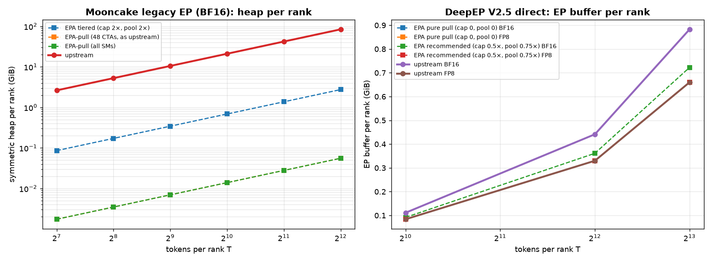
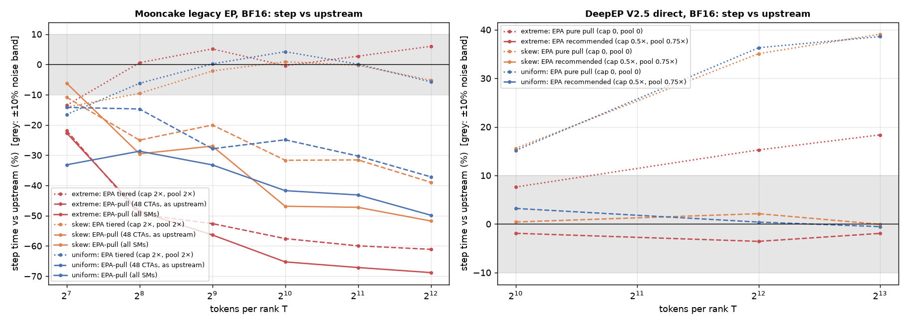

# EPArena results

Generated by `make_results.py` from the JSON next to each benchmark. 8× B300 (NVLink, NV18), R = 8, E = 384, k = 6, H = 7168. Times are medians over ranks of the median over repetitions; "step" is dispatch + combine measured end to end (CUDA graph replay for Mooncake, CUDA events for DeepEP), which includes waiting for the slowest rank. Run-to-run noise of the step time is about ±5–10 % (larger at T = 128).

## Micro-benchmarks

| primitive | value |
|---|---|
| NVLink fetch-add round trip | 1.48 µs |
| local fetch-add round trip | 0.14 µs |
| push/row7424/sm32x256 | 573 GB/s per GPU |
| pull/row7424/sm32x256 | 169 GB/s per GPU |
| push/row7424/sm64x512 | 656 GB/s per GPU |
| pull/row7424/sm64x512 | 567 GB/s per GPU |
| push/row7424/sm132x512 | 684 GB/s per GPU |
| pull/row7424/sm132x512 | 635 GB/s per GPU |
| push/row14352/sm32x256 | 547 GB/s per GPU |
| pull/row14352/sm32x256 | 234 GB/s per GPU |
| push/row14352/sm64x512 | 602 GB/s per GPU |
| pull/row14352/sm64x512 | 618 GB/s per GPU |
| push/row14352/sm132x512 | 616 GB/s per GPU |
| pull/row14352/sm132x512 | 636 GB/s per GPU |
| push/row28672/sm32x256 | 634 GB/s per GPU |
| pull/row28672/sm32x256 | 295 GB/s per GPU |
| push/row28672/sm64x512 | 678 GB/s per GPU |
| pull/row28672/sm64x512 | 650 GB/s per GPU |
| push/row28672/sm132x512 | 696 GB/s per GPU |
| pull/row28672/sm132x512 | 655 GB/s per GPU |
| reserve/lane/sm16 | 471 M lane-requests/s |
| reserve/warp/sm16 | 263 M lane-requests/s |
| reserve/lane/sm64 | 474 M lane-requests/s |
| reserve/warp/sm64 | 1023 M lane-requests/s |
| reserve/lane/sm132 | 475 M lane-requests/s |
| reserve/warp/sm132 | 1759 M lane-requests/s |

## Mooncake legacy EP

Memory = Mooncake's symmetric heap (both ping-pong buffers). Per-call outputs (`packed_recv_x` etc.) are identical in both modes and not included.

#### Tiered EPArena (first design)

| T | routing | dtype | mode | memory | dispatch µs | combine µs | step µs | step vs upstream | tier 2 / tier 3 | bit-equal |
|---|---|---|---|---|---|---|---|---|---|---|
| 128 | uniform | BF16 | upstream | 2.631 GiB | 113 | 62 | 231 | — | 0% / 0% | yes |
| 128 | uniform | BF16 | EPA cap=0 pool=0 (cap 0x, pool 0x) | 0.024 GiB (110× less) | 111 | 61 | 223 | -4% | 0% / 100% | yes |
| 128 | uniform | BF16 | EPA cap=0 pool=960 (cap 0x, pool 1.25x) | 0.029 GiB (89× less) | 99 | 60 | 205 | -11% | 100% / 0% | yes |
| 128 | uniform | BF16 | EPA cap=0 pool=1536 (cap 0x, pool 2x) | 0.045 GiB (59× less) | 100 | 59 | 203 | -12% | 100% / 0% | yes |
| 128 | uniform | BF16 | EPA cap=4 pool=384 (cap 2x, pool 0.5x) | 0.055 GiB (48× less) | 100 | 59 | 221 | -4% | 4% / 0% | yes |
| 128 | uniform | FP8 | upstream | 2.631 GiB | 110 | 62 | 324 | — | 0% / 0% | yes |
| 128 | uniform | FP8 | EPA cap=0 pool=0 (cap 0x, pool 0x) | 0.024 GiB (110× less) | 104 | 59 | 279 | -14% | 0% / 100% | yes |
| 128 | uniform | FP8 | EPA cap=0 pool=960 (cap 0x, pool 1.25x) | 0.029 GiB (89× less) | 97 | 60 | 370 | +14% | 100% / 0% | yes |
| 128 | uniform | FP8 | EPA cap=0 pool=1536 (cap 0x, pool 2x) | 0.045 GiB (59× less) | 96 | 59 | 228 | -30% | 100% / 0% | yes |
| 128 | uniform | FP8 | EPA cap=4 pool=384 (cap 2x, pool 0.5x) | 0.055 GiB (48× less) | 95 | 63 | 337 | +4% | 4% / 0% | yes |
| 128 | skew | BF16 | upstream | 2.631 GiB | 114 | 62 | 237 | — | 0% / 0% | yes |
| 128 | skew | BF16 | EPA cap=0 pool=0 (cap 0x, pool 0x) | 0.024 GiB (110× less) | 109 | 69 | 243 | +3% | 0% / 100% | yes |
| 128 | skew | BF16 | EPA cap=0 pool=960 (cap 0x, pool 1.25x) | 0.029 GiB (89× less) | 92 | 61 | 247 | +4% | 100% / 0% | yes |
| 128 | skew | BF16 | EPA cap=0 pool=1536 (cap 0x, pool 2x) | 0.045 GiB (59× less) | 101 | 59 | 242 | +2% | 100% / 0% | yes |
| 128 | skew | BF16 | EPA cap=4 pool=384 (cap 2x, pool 0.5x) | 0.055 GiB (48× less) | 101 | 59 | 247 | +4% | 7% / 0% | yes |
| 128 | skew | FP8 | upstream | 2.631 GiB | 112 | 62 | 285 | — | 0% / 0% | yes |
| 128 | skew | FP8 | EPA cap=0 pool=0 (cap 0x, pool 0x) | 0.024 GiB (110× less) | 101 | 64 | 238 | -17% | 0% / 100% | yes |
| 128 | skew | FP8 | EPA cap=0 pool=960 (cap 0x, pool 1.25x) | 0.029 GiB (89× less) | 96 | 60 | 203 | -29% | 100% / 0% | yes |
| 128 | skew | FP8 | EPA cap=0 pool=1536 (cap 0x, pool 2x) | 0.045 GiB (59× less) | 96 | 60 | 298 | +4% | 100% / 0% | yes |
| 128 | skew | FP8 | EPA cap=4 pool=384 (cap 2x, pool 0.5x) | 0.055 GiB (48× less) | 95 | 60 | 276 | -3% | 7% / 0% | yes |
| 128 | extreme | BF16 | upstream | 2.631 GiB | 122 | 138 | 318 | — | 0% / 0% | yes |
| 128 | extreme | BF16 | EPA cap=0 pool=0 (cap 0x, pool 0x) | 0.024 GiB (110× less) | 137 | 223 | 468 | +47% | 0% / 100% | yes |
| 128 | extreme | BF16 | EPA cap=0 pool=960 (cap 0x, pool 1.25x) | 0.029 GiB (89× less) | 103 | 248 | 420 | +32% | 93% / 7% | yes |
| 128 | extreme | BF16 | EPA cap=0 pool=1536 (cap 0x, pool 2x) | 0.045 GiB (59× less) | 106 | 132 | 345 | +9% | 100% / 0% | yes |
| 128 | extreme | BF16 | EPA cap=4 pool=384 (cap 2x, pool 0.5x) | 0.055 GiB (48× less) | 103 | 268 | 432 | +36% | 33% / 11% | yes |
| 128 | extreme | FP8 | upstream | 2.631 GiB | 117 | 122 | 333 | — | 0% / 0% | yes |
| 128 | extreme | FP8 | EPA cap=0 pool=0 (cap 0x, pool 0x) | 0.024 GiB (110× less) | 124 | 197 | 379 | +14% | 0% / 100% | yes |
| 128 | extreme | FP8 | EPA cap=0 pool=960 (cap 0x, pool 1.25x) | 0.029 GiB (89× less) | 99 | 225 | 386 | +16% | 93% / 7% | yes |
| 128 | extreme | FP8 | EPA cap=0 pool=1536 (cap 0x, pool 2x) | 0.045 GiB (59× less) | 97 | 122 | 311 | -7% | 100% / 0% | yes |
| 128 | extreme | FP8 | EPA cap=4 pool=384 (cap 2x, pool 0.5x) | 0.055 GiB (48× less) | 99 | 223 | 371 | +11% | 33% / 11% | yes |
| 256 | uniform | BF16 | upstream | 5.262 GiB | 134 | 96 | 363 | +23% | 0% / 0% | yes |
| 256 | uniform | BF16 | EPA cap=0 pool=0 (cap 0x, pool 0x) | 0.048 GiB (110× less) | 140 | 109 | 360 | +22% | 0% / 100% | yes |
| 256 | uniform | BF16 | EPA cap=0 pool=1920 (cap 0x, pool 1.25x) | 0.059 GiB (89× less) | 135 | 95 | 328 | +11% | 100% / 0% | yes |
| 256 | uniform | BF16 | EPA cap=0 pool=3072 (cap 0x, pool 2x) | 0.090 GiB (59× less) | 131 | 95 | 300 | +2% | 100% / 0% | yes |
| 256 | uniform | BF16 | EPA cap=8 pool=768 (cap 2x, pool 0.5x) | 0.110 GiB (48× less) | 135 | 95 | 314 | +7% | 1% / 0% | yes |
| 256 | uniform | FP8 | upstream | 5.262 GiB | 130 | 98 | 311 | — | 0% / 0% | yes |
| 256 | uniform | FP8 | EPA cap=0 pool=0 (cap 0x, pool 0x) | 0.048 GiB (110× less) | 133 | 102 | 302 | -3% | 0% / 100% | yes |
| 256 | uniform | FP8 | EPA cap=0 pool=1920 (cap 0x, pool 1.25x) | 0.059 GiB (89× less) | 127 | 95 | 320 | +3% | 100% / 0% | yes |
| 256 | uniform | FP8 | EPA cap=0 pool=3072 (cap 0x, pool 2x) | 0.090 GiB (59× less) | 127 | 97 | 299 | -4% | 100% / 0% | yes |
| 256 | uniform | FP8 | EPA cap=8 pool=768 (cap 2x, pool 0.5x) | 0.110 GiB (48× less) | 122 | 97 | 297 | -4% | 1% / 0% | yes |
| 256 | skew | BF16 | upstream | 5.262 GiB | 145 | 104 | 349 | +20% | 0% / 0% | yes |
| 256 | skew | BF16 | EPA cap=0 pool=0 (cap 0x, pool 0x) | 0.048 GiB (110× less) | 146 | 131 | 362 | +24% | 0% / 100% | yes |
| 256 | skew | BF16 | EPA cap=0 pool=1920 (cap 0x, pool 1.25x) | 0.059 GiB (89× less) | 135 | 106 | 354 | +22% | 100% / 0% | yes |
| 256 | skew | BF16 | EPA cap=0 pool=3072 (cap 0x, pool 2x) | 0.090 GiB (59× less) | 135 | 106 | 307 | +5% | 100% / 0% | yes |
| 256 | skew | BF16 | EPA cap=8 pool=768 (cap 2x, pool 0.5x) | 0.110 GiB (48× less) | 134 | 106 | 314 | +8% | 4% / 0% | yes |
| 256 | skew | FP8 | upstream | 5.262 GiB | 132 | 100 | 305 | — | 0% / 0% | yes |
| 256 | skew | FP8 | EPA cap=0 pool=0 (cap 0x, pool 0x) | 0.048 GiB (110× less) | 132 | 129 | 320 | +5% | 0% / 100% | yes |
| 256 | skew | FP8 | EPA cap=0 pool=1920 (cap 0x, pool 1.25x) | 0.059 GiB (89× less) | 127 | 101 | 295 | -3% | 100% / 0% | yes |
| 256 | skew | FP8 | EPA cap=0 pool=3072 (cap 0x, pool 2x) | 0.090 GiB (59× less) | 125 | 101 | 281 | -8% | 100% / 0% | yes |
| 256 | skew | FP8 | EPA cap=8 pool=768 (cap 2x, pool 0.5x) | 0.110 GiB (48× less) | 124 | 102 | 296 | -3% | 4% / 0% | yes |
| 256 | extreme | BF16 | upstream | 5.262 GiB | 163 | 266 | 486 | -6% | 0% / 0% | yes |
| 256 | extreme | BF16 | EPA cap=0 pool=0 (cap 0x, pool 0x) | 0.048 GiB (110× less) | 204 | 427 | 723 | +40% | 0% / 100% | yes |
| 256 | extreme | BF16 | EPA cap=0 pool=1920 (cap 0x, pool 1.25x) | 0.059 GiB (89× less) | 156 | 497 | 729 | +41% | 93% / 7% | yes |
| 256 | extreme | BF16 | EPA cap=0 pool=3072 (cap 0x, pool 2x) | 0.090 GiB (59× less) | 156 | 270 | 487 | -6% | 100% / 0% | yes |
| 256 | extreme | BF16 | EPA cap=8 pool=768 (cap 2x, pool 0.5x) | 0.110 GiB (48× less) | 153 | 488 | 723 | +40% | 31% / 12% | yes |
| 256 | extreme | FP8 | upstream | 5.262 GiB | 132 | 249 | 438 | — | 0% / 0% | yes |
| 256 | extreme | FP8 | EPA cap=0 pool=0 (cap 0x, pool 0x) | 0.048 GiB (110× less) | 181 | 361 | 651 | +49% | 0% / 100% | yes |
| 256 | extreme | FP8 | EPA cap=0 pool=1920 (cap 0x, pool 1.25x) | 0.059 GiB (89× less) | 131 | 419 | 641 | +46% | 92% / 8% | yes |
| 256 | extreme | FP8 | EPA cap=0 pool=3072 (cap 0x, pool 2x) | 0.090 GiB (59× less) | 132 | 238 | 461 | +5% | 100% / 0% | yes |
| 256 | extreme | FP8 | EPA cap=8 pool=768 (cap 2x, pool 0.5x) | 0.110 GiB (48× less) | 127 | 413 | 633 | +45% | 31% / 12% | yes |
| 512 | uniform | BF16 | upstream | 10.5 GiB | 199 | 161 | 446 | — | 0% / 0% | yes |
| 512 | uniform | BF16 | EPA cap=0 pool=0 (cap 0x, pool 0x) | 0.096 GiB (110× less) | 225 | 175 | 447 | +0% | 0% / 100% | yes |
| 512 | uniform | BF16 | EPA cap=0 pool=3840 (cap 0x, pool 1.25x) | 0.118 GiB (89× less) | 213 | 159 | 435 | -3% | 100% / 0% | yes |
| 512 | uniform | BF16 | EPA cap=0 pool=6144 (cap 0x, pool 2x) | 0.179 GiB (59× less) | 214 | 161 | 443 | -1% | 100% / 0% | yes |
| 512 | uniform | BF16 | EPA cap=16 pool=1536 (cap 2x, pool 0.5x) | 0.220 GiB (48× less) | 209 | 159 | 409 | -8% | 0% / 0% | yes |
| 512 | uniform | FP8 | upstream | 10.5 GiB | 178 | 164 | 423 | — | 0% / 0% | yes |
| 512 | uniform | FP8 | EPA cap=0 pool=0 (cap 0x, pool 0x) | 0.096 GiB (110× less) | 193 | 171 | 449 | +6% | 0% / 100% | yes |
| 512 | uniform | FP8 | EPA cap=0 pool=3840 (cap 0x, pool 1.25x) | 0.118 GiB (89× less) | 193 | 159 | 428 | +1% | 100% / 0% | yes |
| 512 | uniform | FP8 | EPA cap=0 pool=6144 (cap 0x, pool 2x) | 0.179 GiB (59× less) | 192 | 160 | 436 | +3% | 100% / 0% | yes |
| 512 | uniform | FP8 | EPA cap=16 pool=1536 (cap 2x, pool 0.5x) | 0.220 GiB (48× less) | 182 | 159 | 408 | -4% | 0% / 0% | yes |
| 512 | skew | BF16 | upstream | 10.5 GiB | 191 | 171 | 425 | — | 0% / 0% | yes |
| 512 | skew | BF16 | EPA cap=0 pool=0 (cap 0x, pool 0x) | 0.096 GiB (110× less) | 230 | 174 | 500 | +18% | 0% / 100% | yes |
| 512 | skew | BF16 | EPA cap=0 pool=3840 (cap 0x, pool 1.25x) | 0.118 GiB (89× less) | 214 | 166 | 490 | +15% | 100% / 0% | yes |
| 512 | skew | BF16 | EPA cap=0 pool=6144 (cap 0x, pool 2x) | 0.179 GiB (59× less) | 216 | 166 | 490 | +15% | 100% / 0% | yes |
| 512 | skew | BF16 | EPA cap=16 pool=1536 (cap 2x, pool 0.5x) | 0.220 GiB (48× less) | 210 | 165 | 465 | +10% | 3% / 0% | yes |
| 512 | skew | FP8 | upstream | 10.5 GiB | 178 | 168 | 477 | — | 0% / 0% | yes |
| 512 | skew | FP8 | EPA cap=0 pool=0 (cap 0x, pool 0x) | 0.096 GiB (110× less) | 199 | 168 | 517 | +8% | 0% / 100% | yes |
| 512 | skew | FP8 | EPA cap=0 pool=3840 (cap 0x, pool 1.25x) | 0.118 GiB (89× less) | 191 | 166 | 443 | -7% | 100% / 0% | yes |
| 512 | skew | FP8 | EPA cap=0 pool=6144 (cap 0x, pool 2x) | 0.179 GiB (59× less) | 194 | 165 | 463 | -3% | 100% / 0% | yes |
| 512 | skew | FP8 | EPA cap=16 pool=1536 (cap 2x, pool 0.5x) | 0.220 GiB (48× less) | 183 | 164 | 428 | -10% | 3% / 0% | yes |
| 512 | extreme | BF16 | upstream | 10.5 GiB | 244 | 506 | 866 | — | 0% / 0% | yes |
| 512 | extreme | BF16 | EPA cap=0 pool=0 (cap 0x, pool 0x) | 0.096 GiB (110× less) | 352 | 823 | 1301 | +50% | 0% / 100% | yes |
| 512 | extreme | BF16 | EPA cap=0 pool=3840 (cap 0x, pool 1.25x) | 0.118 GiB (89× less) | 255 | 950 | 1260 | +46% | 94% / 6% | yes |
| 512 | extreme | BF16 | EPA cap=0 pool=6144 (cap 0x, pool 2x) | 0.179 GiB (59× less) | 257 | 491 | 822 | -5% | 100% / 0% | yes |
| 512 | extreme | BF16 | EPA cap=16 pool=1536 (cap 2x, pool 0.5x) | 0.220 GiB (48× less) | 248 | 934 | 1269 | +46% | 31% / 11% | yes |
| 512 | extreme | FP8 | upstream | 10.5 GiB | 201 | 456 | 761 | — | 0% / 0% | yes |
| 512 | extreme | FP8 | EPA cap=0 pool=0 (cap 0x, pool 0x) | 0.096 GiB (110× less) | 297 | 691 | 1128 | +48% | 0% / 100% | yes |
| 512 | extreme | FP8 | EPA cap=0 pool=3840 (cap 0x, pool 1.25x) | 0.118 GiB (89× less) | 215 | 814 | 1162 | +53% | 94% / 6% | yes |
| 512 | extreme | FP8 | EPA cap=0 pool=6144 (cap 0x, pool 2x) | 0.179 GiB (59× less) | 213 | 450 | 756 | -1% | 100% / 0% | yes |
| 512 | extreme | FP8 | EPA cap=16 pool=1536 (cap 2x, pool 0.5x) | 0.220 GiB (48× less) | 207 | 799 | 1101 | +45% | 31% / 11% | yes |
| 1024 | uniform | BF16 | upstream | 21.0 GiB | 371 | 299 | 756 | -1% | 0% / 0% | yes |
| 1024 | uniform | BF16 | EPA cap=0 pool=0 (cap 0x, pool 0x) | 0.191 GiB (110× less) | 419 | 328 | 801 | +5% | 0% / 100% | yes |
| 1024 | uniform | BF16 | EPA cap=0 pool=7680 (cap 0x, pool 1.25x) | 0.236 GiB (89× less) | 410 | 303 | 770 | +1% | 100% / 0% | yes |
| 1024 | uniform | BF16 | EPA cap=0 pool=12288 (cap 0x, pool 2x) | 0.359 GiB (59× less) | 415 | 302 | 813 | +7% | 100% / 0% | yes |
| 1024 | uniform | BF16 | EPA cap=32 pool=3072 (cap 2x, pool 0.5x) | 0.441 GiB (48× less) | 390 | 303 | 775 | +2% | 0% / 0% | yes |
| 1024 | uniform | FP8 | upstream | 21.0 GiB | 321 | 301 | 717 | — | 0% / 0% | yes |
| 1024 | uniform | FP8 | EPA cap=0 pool=0 (cap 0x, pool 0x) | 0.191 GiB (110× less) | 365 | 310 | 744 | +4% | 0% / 100% | yes |
| 1024 | uniform | FP8 | EPA cap=0 pool=7680 (cap 0x, pool 1.25x) | 0.236 GiB (89× less) | 365 | 304 | 769 | +7% | 100% / 0% | yes |
| 1024 | uniform | FP8 | EPA cap=0 pool=12288 (cap 0x, pool 2x) | 0.359 GiB (59× less) | 366 | 301 | 753 | +5% | 100% / 0% | yes |
| 1024 | uniform | FP8 | EPA cap=32 pool=3072 (cap 2x, pool 0.5x) | 0.441 GiB (48× less) | 334 | 301 | 754 | +5% | 0% / 0% | yes |
| 1024 | skew | BF16 | upstream | 21.0 GiB | 379 | 330 | 817 | +7% | 0% / 0% | yes |
| 1024 | skew | BF16 | EPA cap=0 pool=0 (cap 0x, pool 0x) | 0.191 GiB (110× less) | 453 | 395 | 958 | +25% | 0% / 100% | yes |
| 1024 | skew | BF16 | EPA cap=0 pool=7680 (cap 0x, pool 1.25x) | 0.236 GiB (89× less) | 417 | 333 | 831 | +9% | 100% / 0% | yes |
| 1024 | skew | BF16 | EPA cap=0 pool=12288 (cap 0x, pool 2x) | 0.359 GiB (59× less) | 419 | 333 | 835 | +9% | 100% / 0% | yes |
| 1024 | skew | BF16 | EPA cap=32 pool=3072 (cap 2x, pool 0.5x) | 0.441 GiB (48× less) | 397 | 338 | 803 | +5% | 2% / 0% | yes |
| 1024 | skew | FP8 | upstream | 21.0 GiB | 321 | 332 | 737 | — | 0% / 0% | yes |
| 1024 | skew | FP8 | EPA cap=0 pool=0 (cap 0x, pool 0x) | 0.191 GiB (110× less) | 375 | 380 | 849 | +15% | 0% / 100% | yes |
| 1024 | skew | FP8 | EPA cap=0 pool=7680 (cap 0x, pool 1.25x) | 0.236 GiB (89× less) | 373 | 332 | 788 | +7% | 100% / 0% | yes |
| 1024 | skew | FP8 | EPA cap=0 pool=12288 (cap 0x, pool 2x) | 0.359 GiB (59× less) | 370 | 330 | 792 | +7% | 100% / 0% | yes |
| 1024 | skew | FP8 | EPA cap=32 pool=3072 (cap 2x, pool 0.5x) | 0.441 GiB (48× less) | 337 | 333 | 727 | -1% | 2% / 0% | yes |
| 1024 | extreme | BF16 | upstream | 21.0 GiB | 469 | 991 | 1568 | -1% | 0% / 0% | yes |
| 1024 | extreme | BF16 | EPA cap=0 pool=0 (cap 0x, pool 0x) | 0.191 GiB (110× less) | 667 | 1633 | 2431 | +53% | 0% / 100% | yes |
| 1024 | extreme | BF16 | EPA cap=0 pool=7680 (cap 0x, pool 1.25x) | 0.236 GiB (89× less) | 490 | 1832 | 2457 | +54% | 93% / 7% | yes |
| 1024 | extreme | BF16 | EPA cap=0 pool=12288 (cap 0x, pool 2x) | 0.359 GiB (59× less) | 501 | 989 | 1589 | -0% | 100% / 0% | yes |
| 1024 | extreme | BF16 | EPA cap=32 pool=3072 (cap 2x, pool 0.5x) | 0.441 GiB (48× less) | 458 | 1802 | 2408 | +51% | 31% / 11% | yes |
| 1024 | extreme | FP8 | upstream | 21.0 GiB | 390 | 894 | 1386 | — | 0% / 0% | yes |
| 1024 | extreme | FP8 | EPA cap=0 pool=0 (cap 0x, pool 0x) | 0.191 GiB (110× less) | 557 | 1366 | 2066 | +49% | 0% / 100% | yes |
| 1024 | extreme | FP8 | EPA cap=0 pool=7680 (cap 0x, pool 1.25x) | 0.236 GiB (89× less) | 424 | 1531 | 2053 | +48% | 94% / 6% | yes |
| 1024 | extreme | FP8 | EPA cap=0 pool=12288 (cap 0x, pool 2x) | 0.359 GiB (59× less) | 437 | 887 | 1445 | +4% | 100% / 0% | yes |
| 1024 | extreme | FP8 | EPA cap=32 pool=3072 (cap 2x, pool 0.5x) | 0.441 GiB (48× less) | 374 | 1538 | 2012 | +45% | 31% / 11% | yes |
| 2048 | uniform | BF16 | upstream | 42.1 GiB | 753 | 593 | 1432 | — | 0% / 0% | yes |
| 2048 | uniform | BF16 | EPA cap=0 pool=0 (cap 0x, pool 0x) | 0.383 GiB (110× less) | 830 | 601 | 1504 | +5% | 0% / 100% | yes |
| 2048 | uniform | BF16 | EPA cap=0 pool=15360 (cap 0x, pool 1.25x) | 0.471 GiB (89× less) | 830 | 602 | 1491 | +4% | 100% / 0% | yes |
| 2048 | uniform | BF16 | EPA cap=0 pool=24576 (cap 0x, pool 2x) | 0.718 GiB (59× less) | 832 | 594 | 1493 | +4% | 100% / 0% | yes |
| 2048 | uniform | BF16 | EPA cap=64 pool=6144 (cap 2x, pool 0.5x) | 0.882 GiB (48× less) | 762 | 598 | 1474 | +3% | 0% / 0% | yes |
| 2048 | uniform | FP8 | upstream | 42.1 GiB | 660 | 594 | 1338 | — | 0% / 0% | yes |
| 2048 | uniform | FP8 | EPA cap=0 pool=0 (cap 0x, pool 0x) | 0.383 GiB (110× less) | 705 | 597 | 1363 | +2% | 0% / 100% | yes |
| 2048 | uniform | FP8 | EPA cap=0 pool=15360 (cap 0x, pool 1.25x) | 0.471 GiB (89× less) | 742 | 600 | 1441 | +8% | 100% / 0% | yes |
| 2048 | uniform | FP8 | EPA cap=0 pool=24576 (cap 0x, pool 2x) | 0.718 GiB (59× less) | 746 | 595 | 1413 | +6% | 100% / 0% | yes |
| 2048 | uniform | FP8 | EPA cap=64 pool=6144 (cap 2x, pool 0.5x) | 0.882 GiB (48× less) | 681 | 599 | 1364 | +2% | 0% / 0% | yes |
| 2048 | skew | BF16 | upstream | 42.1 GiB | 781 | 651 | 1520 | — | 0% / 0% | yes |
| 2048 | skew | BF16 | EPA cap=0 pool=0 (cap 0x, pool 0x) | 0.383 GiB (110× less) | 888 | 784 | 1762 | +16% | 0% / 100% | yes |
| 2048 | skew | BF16 | EPA cap=0 pool=15360 (cap 0x, pool 1.25x) | 0.471 GiB (89× less) | 855 | 651 | 1575 | +4% | 100% / 0% | yes |
| 2048 | skew | BF16 | EPA cap=0 pool=24576 (cap 0x, pool 2x) | 0.718 GiB (59× less) | 859 | 647 | 1565 | +3% | 100% / 0% | yes |
| 2048 | skew | BF16 | EPA cap=64 pool=6144 (cap 2x, pool 0.5x) | 0.882 GiB (48× less) | 793 | 655 | 1522 | +0% | 2% / 0% | yes |
| 2048 | skew | FP8 | upstream | 42.1 GiB | 678 | 647 | 1378 | — | 0% / 0% | yes |
| 2048 | skew | FP8 | EPA cap=0 pool=0 (cap 0x, pool 0x) | 0.383 GiB (110× less) | 749 | 741 | 1559 | +13% | 0% / 100% | yes |
| 2048 | skew | FP8 | EPA cap=0 pool=15360 (cap 0x, pool 1.25x) | 0.471 GiB (89× less) | 765 | 647 | 1479 | +7% | 100% / 0% | yes |
| 2048 | skew | FP8 | EPA cap=0 pool=24576 (cap 0x, pool 2x) | 0.718 GiB (59× less) | 764 | 646 | 1496 | +9% | 100% / 0% | yes |
| 2048 | skew | FP8 | EPA cap=64 pool=6144 (cap 2x, pool 0.5x) | 0.882 GiB (48× less) | 703 | 656 | 1462 | +6% | 2% / 0% | yes |
| 2048 | extreme | BF16 | upstream | 42.1 GiB | 927 | 2029 | 3110 | — | 0% / 0% | yes |
| 2048 | extreme | BF16 | EPA cap=0 pool=0 (cap 0x, pool 0x) | 0.383 GiB (110× less) | 1368 | 3417 | 5038 | +62% | 0% / 100% | yes |
| 2048 | extreme | BF16 | EPA cap=0 pool=15360 (cap 0x, pool 1.25x) | 0.471 GiB (89× less) | 967 | 3910 | 5040 | +62% | 93% / 7% | yes |
| 2048 | extreme | BF16 | EPA cap=0 pool=24576 (cap 0x, pool 2x) | 0.718 GiB (59× less) | 1003 | 2057 | 3192 | +3% | 100% / 0% | yes |
| 2048 | extreme | BF16 | EPA cap=64 pool=6144 (cap 2x, pool 0.5x) | 0.882 GiB (48× less) | 884 | 3825 | 4913 | +58% | 32% / 11% | yes |
| 2048 | extreme | FP8 | upstream | 42.1 GiB | 794 | 1812 | 2750 | — | 0% / 0% | yes |
| 2048 | extreme | FP8 | EPA cap=0 pool=0 (cap 0x, pool 0x) | 0.383 GiB (110× less) | 1121 | 2859 | 4204 | +53% | 0% / 100% | yes |
| 2048 | extreme | FP8 | EPA cap=0 pool=15360 (cap 0x, pool 1.25x) | 0.471 GiB (89× less) | 812 | 3239 | 4245 | +54% | 94% / 6% | yes |
| 2048 | extreme | FP8 | EPA cap=0 pool=24576 (cap 0x, pool 2x) | 0.718 GiB (59× less) | 862 | 1849 | 2835 | +3% | 100% / 0% | yes |
| 2048 | extreme | FP8 | EPA cap=64 pool=6144 (cap 2x, pool 0.5x) | 0.882 GiB (48× less) | 742 | 3178 | 4118 | +50% | 32% / 11% | yes |
| 4096 | uniform | BF16 | upstream | 84.2 GiB | 1580 | 1514 | 3167 | +2% | 0% / 0% | yes |
| 4096 | uniform | BF16 | EPA cap=0 pool=0 (cap 0x, pool 0x) | 0.766 GiB (110× less) | 1627 | 1241 | 3042 | -2% | 0% / 100% | yes |
| 4096 | uniform | BF16 | EPA cap=0 pool=30720 (cap 0x, pool 1.25x) | 0.942 GiB (89× less) | 1655 | 1288 | 3013 | -3% | 100% / 0% | yes |
| 4096 | uniform | BF16 | EPA cap=0 pool=49152 (cap 0x, pool 2x) | 1.435 GiB (59× less) | 1655 | 1302 | 3020 | -3% | 100% / 0% | yes |
| 4096 | uniform | BF16 | EPA cap=128 pool=12288 (cap 2x, pool 0.5x) | 1.764 GiB (48× less) | 1574 | 1279 | 2922 | -6% | 0% / 0% | yes |
| 4096 | uniform | FP8 | upstream | 84.2 GiB | 1364 | 1463 | 2912 | — | 0% / 0% | yes |
| 4096 | uniform | FP8 | EPA cap=0 pool=0 (cap 0x, pool 0x) | 0.766 GiB (110× less) | 1334 | 1259 | 2684 | -8% | 0% / 100% | yes |
| 4096 | uniform | FP8 | EPA cap=0 pool=30720 (cap 0x, pool 1.25x) | 0.942 GiB (89× less) | 1481 | 1248 | 2806 | -4% | 100% / 0% | yes |
| 4096 | uniform | FP8 | EPA cap=0 pool=49152 (cap 0x, pool 2x) | 1.435 GiB (59× less) | 1485 | 1273 | 2848 | -2% | 100% / 0% | yes |
| 4096 | uniform | FP8 | EPA cap=128 pool=12288 (cap 2x, pool 0.5x) | 1.764 GiB (48× less) | 1370 | 1272 | 2726 | -6% | 0% / 0% | yes |
| 4096 | skew | BF16 | upstream | 84.2 GiB | 1667 | 1557 | 3311 | +2% | 0% / 0% | yes |
| 4096 | skew | BF16 | EPA cap=0 pool=0 (cap 0x, pool 0x) | 0.766 GiB (110× less) | 1819 | 1525 | 3459 | +6% | 0% / 100% | yes |
| 4096 | skew | BF16 | EPA cap=0 pool=30720 (cap 0x, pool 1.25x) | 0.942 GiB (89× less) | 1735 | 1350 | 3177 | -3% | 100% / 0% | yes |
| 4096 | skew | BF16 | EPA cap=0 pool=49152 (cap 0x, pool 2x) | 1.435 GiB (59× less) | 1738 | 1351 | 3182 | -2% | 100% / 0% | yes |
| 4096 | skew | BF16 | EPA cap=128 pool=12288 (cap 2x, pool 0.5x) | 1.764 GiB (48× less) | 1650 | 1342 | 3109 | -5% | 2% / 0% | yes |
| 4096 | skew | FP8 | upstream | 84.2 GiB | 1421 | 1513 | 3020 | — | 0% / 0% | yes |
| 4096 | skew | FP8 | EPA cap=0 pool=0 (cap 0x, pool 0x) | 0.766 GiB (110× less) | 1500 | 1484 | 3028 | +0% | 0% / 100% | yes |
| 4096 | skew | FP8 | EPA cap=0 pool=30720 (cap 0x, pool 1.25x) | 0.942 GiB (89× less) | 1529 | 1338 | 2954 | -2% | 100% / 0% | yes |
| 4096 | skew | FP8 | EPA cap=0 pool=49152 (cap 0x, pool 2x) | 1.435 GiB (59× less) | 1539 | 1338 | 2957 | -2% | 100% / 0% | yes |
| 4096 | skew | FP8 | EPA cap=128 pool=12288 (cap 2x, pool 0.5x) | 1.764 GiB (48× less) | 1404 | 1340 | 2841 | -6% | 2% / 0% | yes |
| 4096 | extreme | BF16 | upstream | 84.2 GiB | 1983 | 4225 | 6383 | -1% | 0% / 0% | yes |
| 4096 | extreme | BF16 | EPA cap=0 pool=0 (cap 0x, pool 0x) | 0.766 GiB (110× less) | 2823 | 7192 | 10314 | +61% | 0% / 100% | yes |
| 4096 | extreme | BF16 | EPA cap=0 pool=30720 (cap 0x, pool 1.25x) | 0.942 GiB (89× less) | 2101 | 7949 | 10265 | +60% | 94% / 6% | yes |
| 4096 | extreme | BF16 | EPA cap=0 pool=49152 (cap 0x, pool 2x) | 1.435 GiB (59× less) | 2292 | 4420 | 6885 | +7% | 100% / 0% | yes |
| 4096 | extreme | BF16 | EPA cap=128 pool=12288 (cap 2x, pool 0.5x) | 1.764 GiB (48× less) | 2052 | 7792 | 10050 | +56% | 30% / 12% | yes |
| 4096 | extreme | FP8 | upstream | 84.2 GiB | 1640 | 3790 | 5592 | — | 0% / 0% | yes |
| 4096 | extreme | FP8 | EPA cap=0 pool=0 (cap 0x, pool 0x) | 0.766 GiB (110× less) | 2319 | 5989 | 8565 | +53% | 0% / 100% | yes |
| 4096 | extreme | FP8 | EPA cap=0 pool=30720 (cap 0x, pool 1.25x) | 0.942 GiB (89× less) | 1794 | 6535 | 8490 | +52% | 94% / 6% | yes |
| 4096 | extreme | FP8 | EPA cap=0 pool=49152 (cap 0x, pool 2x) | 1.435 GiB (59× less) | 1950 | 3913 | 6054 | +8% | 100% / 0% | yes |
| 4096 | extreme | FP8 | EPA cap=128 pool=12288 (cap 2x, pool 0.5x) | 1.764 GiB (48× less) | 1746 | 6461 | 8402 | +50% | 31% / 11% | yes |
| 256 | uniform | BF16 | upstream | 5.262 GiB | 137 | 97 | 295 | — | 0% / 0% | yes |
| 256 | uniform | BF16 | EPA cap=4 pool=3072 (cap 1x, pool 2x) | 0.131 GiB (40× less) | 135 | 95 | 284 | -4% | 19% / 0% | yes |
| 256 | uniform | BF16 | EPA cap=8 pool=3072 (cap 2x, pool 2x) | 0.172 GiB (31× less) | 135 | 94 | 275 | -7% | 1% / 0% | yes |
| 256 | skew | BF16 | upstream | 5.262 GiB | 143 | 103 | 291 | — | 0% / 0% | yes |
| 256 | skew | BF16 | EPA cap=4 pool=3072 (cap 1x, pool 2x) | 0.131 GiB (40× less) | 133 | 104 | 284 | -2% | 23% / 0% | yes |
| 256 | skew | BF16 | EPA cap=8 pool=3072 (cap 2x, pool 2x) | 0.172 GiB (31× less) | 132 | 103 | 289 | -1% | 4% / 0% | yes |
| 256 | extreme | BF16 | upstream | 5.262 GiB | 159 | 274 | 516 | — | 0% / 0% | yes |
| 256 | extreme | BF16 | EPA cap=4 pool=3072 (cap 1x, pool 2x) | 0.131 GiB (40× less) | 155 | 267 | 513 | -1% | 56% / 0% | yes |
| 256 | extreme | BF16 | EPA cap=8 pool=3072 (cap 2x, pool 2x) | 0.172 GiB (31× less) | 152 | 269 | 487 | -6% | 43% / 0% | yes |
| 1024 | uniform | BF16 | upstream | 21.0 GiB | 373 | 301 | 763 | — | 0% / 0% | yes |
| 1024 | uniform | BF16 | EPA cap=16 pool=12288 (cap 1x, pool 2x) | 0.523 GiB (40× less) | 389 | 304 | 777 | +2% | 10% / 0% | yes |
| 1024 | uniform | BF16 | EPA cap=32 pool=12288 (cap 2x, pool 2x) | 0.687 GiB (31× less) | 384 | 304 | 763 | +0% | 0% / 0% | yes |
| 1024 | skew | BF16 | upstream | 21.0 GiB | 375 | 332 | 766 | — | 0% / 0% | yes |
| 1024 | skew | BF16 | EPA cap=16 pool=12288 (cap 1x, pool 2x) | 0.523 GiB (40× less) | 393 | 338 | 797 | +4% | 16% / 0% | yes |
| 1024 | skew | BF16 | EPA cap=32 pool=12288 (cap 2x, pool 2x) | 0.687 GiB (31× less) | 395 | 335 | 798 | +4% | 2% / 0% | yes |
| 1024 | extreme | BF16 | upstream | 21.0 GiB | 477 | 989 | 1590 | — | 0% / 0% | yes |
| 1024 | extreme | BF16 | EPA cap=16 pool=12288 (cap 1x, pool 2x) | 0.523 GiB (40× less) | 494 | 993 | 1595 | +0% | 54% / 0% | yes |
| 1024 | extreme | BF16 | EPA cap=32 pool=12288 (cap 2x, pool 2x) | 0.687 GiB (31× less) | 486 | 991 | 1585 | -0% | 42% / 0% | yes |
| 4096 | uniform | BF16 | upstream | 84.2 GiB | 1584 | 1475 | 3113 | — | 0% / 0% | yes |
| 4096 | uniform | BF16 | EPA cap=64 pool=49152 (cap 1x, pool 2x) | 2.092 GiB (40× less) | 1579 | 1295 | 2927 | -6% | 5% / 0% | yes |
| 4096 | uniform | BF16 | EPA cap=128 pool=49152 (cap 2x, pool 2x) | 2.749 GiB (31× less) | 1572 | 1326 | 2931 | -6% | 0% / 0% | yes |
| 4096 | skew | BF16 | upstream | 84.2 GiB | 1666 | 1518 | 3259 | — | 0% / 0% | yes |
| 4096 | skew | BF16 | EPA cap=64 pool=49152 (cap 1x, pool 2x) | 2.092 GiB (40× less) | 1651 | 1346 | 3125 | -4% | 13% / 0% | yes |
| 4096 | skew | BF16 | EPA cap=128 pool=49152 (cap 2x, pool 2x) | 2.749 GiB (31× less) | 1653 | 1360 | 3126 | -4% | 2% / 0% | yes |
| 4096 | extreme | BF16 | upstream | 84.2 GiB | 2007 | 4214 | 6424 | — | 0% / 0% | yes |
| 4096 | extreme | BF16 | EPA cap=64 pool=49152 (cap 1x, pool 2x) | 2.092 GiB (40× less) | 2117 | 4410 | 6803 | +6% | 53% / 0% | yes |
| 4096 | extreme | BF16 | EPA cap=128 pool=49152 (cap 2x, pool 2x) | 2.749 GiB (31× less) | 2173 | 4427 | 6864 | +7% | 42% / 0% | yes |

### EPA-pull (second design)

`heap` for EPA-pull excludes the expert output `y`, which it keeps in the symmetric heap (upstream keeps the same tensor as an ordinary allocation).

#### EPA-pull, all SMs

| T | routing | dtype | mode | memory | dispatch µs | combine µs | step µs | step vs upstream | tier 2 / tier 3 | bit-equal |
|---|---|---|---|---|---|---|---|---|---|---|
| 128 | uniform | BF16 | upstream | 2.631 GiB | 117 | 63 | 299 | — | 0% / 0% | yes |
| 128 | uniform | BF16 | EPA cap=4 pool=1536 (cap 2x, pool 2x) | 0.086 GiB (31× less) | 91 | 60 | 250 | -17% | 4% / 0% | yes |
| 128 | uniform | BF16 | EPA-pull | 0.002 GiB (1510× less) | 105 | 42 | 200 | -33% | 0% / 0% | yes |
| 128 | uniform | FP8 | upstream | 2.631 GiB | 102 | 61 | 252 | — | 0% / 0% | yes |
| 128 | uniform | FP8 | EPA cap=4 pool=1536 (cap 2x, pool 2x) | 0.086 GiB (31× less) | 95 | 59 | 244 | -3% | 4% / 0% | yes |
| 128 | uniform | FP8 | EPA-pull | 0.002 GiB (1510× less) | 94 | 36 | 201 | -21% | 0% / 0% | yes |
| 128 | skew | BF16 | upstream | 2.631 GiB | 118 | 63 | 283 | — | 0% / 0% | yes |
| 128 | skew | BF16 | EPA cap=4 pool=1536 (cap 2x, pool 2x) | 0.086 GiB (31× less) | 100 | 60 | 243 | -14% | 7% / 0% | yes |
| 128 | skew | BF16 | EPA-pull | 0.002 GiB (1510× less) | 109 | 52 | 266 | -6% | 0% / 0% | yes |
| 128 | skew | FP8 | upstream | 2.631 GiB | 104 | 64 | 237 | — | 0% / 0% | yes |
| 128 | skew | FP8 | EPA cap=4 pool=1536 (cap 2x, pool 2x) | 0.086 GiB (31× less) | 91 | 60 | 216 | -9% | 7% / 0% | yes |
| 128 | skew | FP8 | EPA-pull | 0.002 GiB (1510× less) | 95 | 41 | 190 | -20% | 0% / 0% | yes |
| 128 | extreme | BF16 | upstream | 2.631 GiB | 122 | 124 | 322 | — | 0% / 0% | yes |
| 128 | extreme | BF16 | EPA cap=4 pool=1536 (cap 2x, pool 2x) | 0.086 GiB (31× less) | 102 | 122 | 279 | -14% | 44% / 0% | yes |
| 128 | extreme | BF16 | EPA-pull | 0.002 GiB (1510× less) | 110 | 56 | 249 | -23% | 0% / 0% | yes |
| 128 | extreme | FP8 | upstream | 2.631 GiB | 117 | 118 | 337 | — | 0% / 0% | yes |
| 128 | extreme | FP8 | EPA cap=4 pool=1536 (cap 2x, pool 2x) | 0.086 GiB (31× less) | 97 | 120 | 286 | -15% | 44% / 0% | yes |
| 128 | extreme | FP8 | EPA-pull | 0.002 GiB (1510× less) | 94 | 54 | 225 | -33% | 0% / 0% | yes |
| 256 | uniform | BF16 | upstream | 5.262 GiB | 135 | 106 | 298 | — | 0% / 0% | yes |
| 256 | uniform | BF16 | EPA cap=8 pool=3072 (cap 2x, pool 2x) | 0.172 GiB (31× less) | 134 | 95 | 279 | -6% | 1% / 0% | yes |
| 256 | uniform | BF16 | EPA-pull | 0.003 GiB (1510× less) | 114 | 57 | 212 | -29% | 0% / 0% | yes |
| 256 | uniform | FP8 | upstream | 5.262 GiB | 131 | 97 | 317 | — | 0% / 0% | yes |
| 256 | uniform | FP8 | EPA cap=8 pool=3072 (cap 2x, pool 2x) | 0.172 GiB (31× less) | 124 | 96 | 316 | -0% | 1% / 0% | yes |
| 256 | uniform | FP8 | EPA-pull | 0.003 GiB (1510× less) | 99 | 55 | 233 | -26% | 0% / 0% | yes |
| 256 | skew | BF16 | upstream | 5.262 GiB | 135 | 104 | 326 | — | 0% / 0% | yes |
| 256 | skew | BF16 | EPA cap=8 pool=3072 (cap 2x, pool 2x) | 0.172 GiB (31× less) | 135 | 106 | 295 | -10% | 4% / 0% | yes |
| 256 | skew | BF16 | EPA-pull | 0.003 GiB (1510× less) | 109 | 58 | 230 | -30% | 0% / 0% | yes |
| 256 | skew | FP8 | upstream | 5.262 GiB | 132 | 101 | 292 | — | 0% / 0% | yes |
| 256 | skew | FP8 | EPA cap=8 pool=3072 (cap 2x, pool 2x) | 0.172 GiB (31× less) | 124 | 100 | 281 | -4% | 4% / 0% | yes |
| 256 | skew | FP8 | EPA-pull | 0.003 GiB (1510× less) | 100 | 60 | 230 | -21% | 0% / 0% | yes |
| 256 | extreme | BF16 | upstream | 5.262 GiB | 160 | 268 | 527 | — | 0% / 0% | yes |
| 256 | extreme | BF16 | EPA cap=8 pool=3072 (cap 2x, pool 2x) | 0.172 GiB (31× less) | 151 | 266 | 530 | +1% | 43% / 0% | yes |
| 256 | extreme | BF16 | EPA-pull | 0.003 GiB (1510× less) | 108 | 91 | 271 | -49% | 0% / 0% | yes |
| 256 | extreme | FP8 | upstream | 5.262 GiB | 141 | 239 | 449 | — | 0% / 0% | yes |
| 256 | extreme | FP8 | EPA cap=8 pool=3072 (cap 2x, pool 2x) | 0.172 GiB (31× less) | 132 | 229 | 431 | -4% | 43% / 0% | yes |
| 256 | extreme | FP8 | EPA-pull | 0.003 GiB (1510× less) | 93 | 89 | 235 | -48% | 0% / 0% | yes |
| 512 | uniform | BF16 | upstream | 10.5 GiB | 192 | 158 | 453 | — | 0% / 0% | yes |
| 512 | uniform | BF16 | EPA cap=16 pool=6144 (cap 2x, pool 2x) | 0.344 GiB (31× less) | 211 | 159 | 454 | +0% | 0% / 0% | yes |
| 512 | uniform | BF16 | EPA-pull | 0.007 GiB (1511× less) | 135 | 98 | 303 | -33% | 0% / 0% | yes |
| 512 | uniform | FP8 | upstream | 10.5 GiB | 180 | 156 | 400 | — | 0% / 0% | yes |
| 512 | uniform | FP8 | EPA cap=16 pool=6144 (cap 2x, pool 2x) | 0.344 GiB (31× less) | 184 | 157 | 422 | +5% | 0% / 0% | yes |
| 512 | uniform | FP8 | EPA-pull | 0.007 GiB (1511× less) | 113 | 92 | 269 | -33% | 0% / 0% | yes |
| 512 | skew | BF16 | upstream | 10.5 GiB | 192 | 177 | 423 | — | 0% / 0% | yes |
| 512 | skew | BF16 | EPA cap=16 pool=6144 (cap 2x, pool 2x) | 0.344 GiB (31× less) | 211 | 167 | 414 | -2% | 3% / 0% | yes |
| 512 | skew | BF16 | EPA-pull | 0.007 GiB (1511× less) | 134 | 105 | 309 | -27% | 0% / 0% | yes |
| 512 | skew | FP8 | upstream | 10.5 GiB | 182 | 168 | 412 | — | 0% / 0% | yes |
| 512 | skew | FP8 | EPA cap=16 pool=6144 (cap 2x, pool 2x) | 0.344 GiB (31× less) | 184 | 166 | 426 | +3% | 3% / 0% | yes |
| 512 | skew | FP8 | EPA-pull | 0.007 GiB (1511× less) | 113 | 100 | 271 | -34% | 0% / 0% | yes |
| 512 | extreme | BF16 | upstream | 10.5 GiB | 246 | 483 | 804 | — | 0% / 0% | yes |
| 512 | extreme | BF16 | EPA cap=16 pool=6144 (cap 2x, pool 2x) | 0.344 GiB (31× less) | 258 | 481 | 846 | +5% | 42% / 0% | yes |
| 512 | extreme | BF16 | EPA-pull | 0.007 GiB (1511× less) | 134 | 153 | 351 | -56% | 0% / 0% | yes |
| 512 | extreme | FP8 | upstream | 10.5 GiB | 195 | 463 | 736 | — | 0% / 0% | yes |
| 512 | extreme | FP8 | EPA cap=16 pool=6144 (cap 2x, pool 2x) | 0.344 GiB (31× less) | 215 | 445 | 733 | -0% | 42% / 0% | yes |
| 512 | extreme | FP8 | EPA-pull | 0.007 GiB (1511× less) | 108 | 142 | 316 | -57% | 0% / 0% | yes |
| 1024 | uniform | BF16 | upstream | 21.0 GiB | 373 | 300 | 759 | — | 0% / 0% | yes |
| 1024 | uniform | BF16 | EPA cap=32 pool=12288 (cap 2x, pool 2x) | 0.687 GiB (31× less) | 388 | 304 | 791 | +4% | 0% / 0% | yes |
| 1024 | uniform | BF16 | EPA-pull | 0.014 GiB (1511× less) | 191 | 165 | 442 | -42% | 0% / 0% | yes |
| 1024 | uniform | FP8 | upstream | 21.0 GiB | 318 | 300 | 722 | — | 0% / 0% | yes |
| 1024 | uniform | FP8 | EPA cap=32 pool=12288 (cap 2x, pool 2x) | 0.687 GiB (31× less) | 334 | 304 | 722 | +0% | 0% / 0% | yes |
| 1024 | uniform | FP8 | EPA-pull | 0.014 GiB (1511× less) | 144 | 164 | 376 | -48% | 0% / 0% | yes |
| 1024 | skew | BF16 | upstream | 21.0 GiB | 377 | 342 | 829 | — | 0% / 0% | yes |
| 1024 | skew | BF16 | EPA cap=32 pool=12288 (cap 2x, pool 2x) | 0.687 GiB (31× less) | 398 | 338 | 837 | +1% | 2% / 0% | yes |
| 1024 | skew | BF16 | EPA-pull | 0.014 GiB (1511× less) | 195 | 172 | 441 | -47% | 0% / 0% | yes |
| 1024 | skew | FP8 | upstream | 21.0 GiB | 324 | 327 | 716 | — | 0% / 0% | yes |
| 1024 | skew | FP8 | EPA cap=32 pool=12288 (cap 2x, pool 2x) | 0.687 GiB (31× less) | 334 | 333 | 755 | +5% | 2% / 0% | yes |
| 1024 | skew | FP8 | EPA-pull | 0.014 GiB (1511× less) | 142 | 169 | 380 | -47% | 0% / 0% | yes |
| 1024 | extreme | BF16 | upstream | 21.0 GiB | 467 | 988 | 1603 | — | 0% / 0% | yes |
| 1024 | extreme | BF16 | EPA cap=32 pool=12288 (cap 2x, pool 2x) | 0.687 GiB (31× less) | 481 | 991 | 1596 | -0% | 42% / 0% | yes |
| 1024 | extreme | BF16 | EPA-pull | 0.014 GiB (1511× less) | 198 | 285 | 557 | -65% | 0% / 0% | yes |
| 1024 | extreme | FP8 | upstream | 21.0 GiB | 358 | 900 | 1380 | — | 0% / 0% | yes |
| 1024 | extreme | FP8 | EPA cap=32 pool=12288 (cap 2x, pool 2x) | 0.687 GiB (31× less) | 407 | 895 | 1458 | +6% | 42% / 0% | yes |
| 1024 | extreme | FP8 | EPA-pull | 0.014 GiB (1511× less) | 146 | 257 | 472 | -66% | 0% / 0% | yes |
| 2048 | uniform | BF16 | upstream | 42.1 GiB | 747 | 594 | 1442 | — | 0% / 0% | yes |
| 2048 | uniform | BF16 | EPA cap=64 pool=24576 (cap 2x, pool 2x) | 1.375 GiB (31× less) | 761 | 594 | 1443 | +0% | 0% / 0% | yes |
| 2048 | uniform | BF16 | EPA-pull | 0.028 GiB (1511× less) | 408 | 316 | 819 | -43% | 0% / 0% | yes |
| 2048 | uniform | FP8 | upstream | 42.1 GiB | 652 | 593 | 1358 | — | 0% / 0% | yes |
| 2048 | uniform | FP8 | EPA cap=64 pool=24576 (cap 2x, pool 2x) | 1.375 GiB (31× less) | 683 | 597 | 1339 | -1% | 0% / 0% | yes |
| 2048 | uniform | FP8 | EPA-pull | 0.028 GiB (1511× less) | 251 | 316 | 639 | -53% | 0% / 0% | yes |
| 2048 | skew | BF16 | upstream | 42.1 GiB | 781 | 656 | 1514 | — | 0% / 0% | yes |
| 2048 | skew | BF16 | EPA cap=64 pool=24576 (cap 2x, pool 2x) | 1.375 GiB (31× less) | 796 | 650 | 1510 | -0% | 2% / 0% | yes |
| 2048 | skew | BF16 | EPA-pull | 0.028 GiB (1511× less) | 409 | 316 | 799 | -47% | 0% / 0% | yes |
| 2048 | skew | FP8 | upstream | 42.1 GiB | 674 | 645 | 1391 | — | 0% / 0% | yes |
| 2048 | skew | FP8 | EPA cap=64 pool=24576 (cap 2x, pool 2x) | 1.375 GiB (31× less) | 698 | 653 | 1439 | +3% | 2% / 0% | yes |
| 2048 | skew | FP8 | EPA-pull | 0.028 GiB (1511× less) | 250 | 313 | 637 | -54% | 0% / 0% | yes |
| 2048 | extreme | BF16 | upstream | 42.1 GiB | 923 | 2025 | 3103 | — | 0% / 0% | yes |
| 2048 | extreme | BF16 | EPA cap=64 pool=24576 (cap 2x, pool 2x) | 1.375 GiB (31× less) | 952 | 2069 | 3188 | +3% | 42% / 0% | yes |
| 2048 | extreme | BF16 | EPA-pull | 0.028 GiB (1511× less) | 355 | 563 | 1020 | -67% | 0% / 0% | yes |
| 2048 | extreme | FP8 | upstream | 42.1 GiB | 796 | 1802 | 2742 | — | 0% / 0% | yes |
| 2048 | extreme | FP8 | EPA cap=64 pool=24576 (cap 2x, pool 2x) | 1.375 GiB (31× less) | 811 | 1850 | 2801 | +2% | 42% / 0% | yes |
| 2048 | extreme | FP8 | EPA-pull | 0.028 GiB (1511× less) | 239 | 503 | 819 | -70% | 0% / 0% | yes |
| 4096 | uniform | BF16 | upstream | 84.2 GiB | 1588 | 1475 | 3126 | — | 0% / 0% | yes |
| 4096 | uniform | BF16 | EPA cap=128 pool=49152 (cap 2x, pool 2x) | 2.749 GiB (31× less) | 1572 | 1297 | 2945 | -6% | 0% / 0% | yes |
| 4096 | uniform | BF16 | EPA-pull | 0.056 GiB (1511× less) | 872 | 601 | 1567 | -50% | 0% / 0% | yes |
| 4096 | uniform | FP8 | upstream | 84.2 GiB | 1369 | 1472 | 2957 | — | 0% / 0% | yes |
| 4096 | uniform | FP8 | EPA cap=128 pool=49152 (cap 2x, pool 2x) | 2.749 GiB (31× less) | 1371 | 1276 | 2731 | -8% | 0% / 0% | yes |
| 4096 | uniform | FP8 | EPA-pull | 0.056 GiB (1511× less) | 492 | 612 | 1174 | -60% | 0% / 0% | yes |
| 4096 | skew | BF16 | upstream | 84.2 GiB | 1667 | 1531 | 3301 | — | 0% / 0% | yes |
| 4096 | skew | BF16 | EPA cap=128 pool=49152 (cap 2x, pool 2x) | 2.749 GiB (31× less) | 1666 | 1342 | 3128 | -5% | 2% / 0% | yes |
| 4096 | skew | BF16 | EPA-pull | 0.056 GiB (1511× less) | 882 | 614 | 1592 | -52% | 0% / 0% | yes |
| 4096 | skew | FP8 | upstream | 84.2 GiB | 1428 | 1476 | 3006 | — | 0% / 0% | yes |
| 4096 | skew | FP8 | EPA cap=128 pool=49152 (cap 2x, pool 2x) | 2.749 GiB (31× less) | 1403 | 1367 | 2852 | -5% | 2% / 0% | yes |
| 4096 | skew | FP8 | EPA-pull | 0.056 GiB (1511× less) | 495 | 618 | 1201 | -60% | 0% / 0% | yes |
| 4096 | extreme | BF16 | upstream | 84.2 GiB | 1955 | 4232 | 6377 | — | 0% / 0% | yes |
| 4096 | extreme | BF16 | EPA cap=128 pool=49152 (cap 2x, pool 2x) | 2.749 GiB (31× less) | 2143 | 4407 | 6758 | +6% | 42% / 0% | yes |
| 4096 | extreme | BF16 | EPA-pull | 0.056 GiB (1511× less) | 731 | 1163 | 1988 | -69% | 0% / 0% | yes |
| 4096 | extreme | FP8 | upstream | 84.2 GiB | 1626 | 3769 | 5571 | — | 0% / 0% | yes |
| 4096 | extreme | FP8 | EPA cap=128 pool=49152 (cap 2x, pool 2x) | 2.749 GiB (31× less) | 1773 | 3915 | 5877 | +6% | 42% / 0% | yes |
| 4096 | extreme | FP8 | EPA-pull | 0.056 GiB (1511× less) | 446 | 997 | 1521 | -73% | 0% / 0% | yes |

#### EPA-pull limited to 48 CTAs (upstream's SM count), BF16

| T | routing | dtype | mode | memory | dispatch µs | combine µs | step µs | step vs upstream | tier 2 / tier 3 | bit-equal |
|---|---|---|---|---|---|---|---|---|---|---|
| 128 | uniform | BF16 | upstream | 2.631 GiB | 117 | 63 | 299 | — | 0% / 0% | yes |
| 128 | skew | BF16 | upstream | 2.631 GiB | 118 | 63 | 283 | — | 0% / 0% | yes |
| 128 | extreme | BF16 | upstream | 2.631 GiB | 122 | 124 | 322 | — | 0% / 0% | yes |
| 256 | uniform | BF16 | upstream | 5.262 GiB | 135 | 106 | 298 | — | 0% / 0% | yes |
| 256 | skew | BF16 | upstream | 5.262 GiB | 135 | 104 | 326 | — | 0% / 0% | yes |
| 256 | extreme | BF16 | upstream | 5.262 GiB | 160 | 268 | 527 | — | 0% / 0% | yes |
| 512 | uniform | BF16 | upstream | 10.5 GiB | 192 | 158 | 453 | — | 0% / 0% | yes |
| 512 | skew | BF16 | upstream | 10.5 GiB | 192 | 177 | 423 | — | 0% / 0% | yes |
| 512 | extreme | BF16 | upstream | 10.5 GiB | 246 | 483 | 804 | — | 0% / 0% | yes |
| 1024 | uniform | BF16 | upstream | 21.0 GiB | 373 | 300 | 759 | — | 0% / 0% | yes |
| 1024 | skew | BF16 | upstream | 21.0 GiB | 377 | 342 | 829 | — | 0% / 0% | yes |
| 1024 | extreme | BF16 | upstream | 21.0 GiB | 467 | 988 | 1603 | — | 0% / 0% | yes |
| 2048 | uniform | BF16 | upstream | 42.1 GiB | 747 | 594 | 1442 | — | 0% / 0% | yes |
| 2048 | skew | BF16 | upstream | 42.1 GiB | 781 | 656 | 1514 | — | 0% / 0% | yes |
| 2048 | extreme | BF16 | upstream | 42.1 GiB | 923 | 2025 | 3103 | — | 0% / 0% | yes |
| 4096 | uniform | BF16 | upstream | 84.2 GiB | 1588 | 1475 | 3126 | — | 0% / 0% | yes |
| 4096 | skew | BF16 | upstream | 84.2 GiB | 1667 | 1531 | 3301 | — | 0% / 0% | yes |
| 4096 | extreme | BF16 | upstream | 84.2 GiB | 1955 | 4232 | 6377 | — | 0% / 0% | yes |
| 128 | uniform | BF16 | EPA-pull (48 CTAs) | 0.002 GiB (1510× less) | 103 | 54 | 257 | -14% | 0% / 0% | yes |
| 128 | skew | BF16 | EPA-pull (48 CTAs) | 0.002 GiB (1510× less) | 108 | 61 | 253 | -11% | 0% / 0% | yes |
| 128 | extreme | BF16 | EPA-pull (48 CTAs) | 0.002 GiB (1510× less) | 109 | 66 | 252 | -22% | 0% / 0% | yes |
| 256 | uniform | BF16 | EPA-pull (48 CTAs) | 0.003 GiB (1510× less) | 111 | 72 | 254 | -15% | 0% / 0% | yes |
| 256 | skew | BF16 | EPA-pull (48 CTAs) | 0.003 GiB (1510× less) | 110 | 74 | 245 | -25% | 0% / 0% | yes |
| 256 | extreme | BF16 | EPA-pull (48 CTAs) | 0.003 GiB (1510× less) | 105 | 101 | 266 | -50% | 0% / 0% | yes |
| 512 | uniform | BF16 | EPA-pull (48 CTAs) | 0.007 GiB (1511× less) | 136 | 124 | 327 | -28% | 0% / 0% | yes |
| 512 | skew | BF16 | EPA-pull (48 CTAs) | 0.007 GiB (1511× less) | 133 | 134 | 339 | -20% | 0% / 0% | yes |
| 512 | extreme | BF16 | EPA-pull (48 CTAs) | 0.007 GiB (1511× less) | 130 | 194 | 381 | -53% | 0% / 0% | yes |
| 1024 | uniform | BF16 | EPA-pull (48 CTAs) | 0.014 GiB (1511× less) | 251 | 236 | 570 | -25% | 0% / 0% | yes |
| 1024 | skew | BF16 | EPA-pull (48 CTAs) | 0.014 GiB (1511× less) | 246 | 242 | 567 | -32% | 0% / 0% | yes |
| 1024 | extreme | BF16 | EPA-pull (48 CTAs) | 0.014 GiB (1511× less) | 236 | 374 | 680 | -58% | 0% / 0% | yes |
| 2048 | uniform | BF16 | EPA-pull (48 CTAs) | 0.028 GiB (1511× less) | 500 | 428 | 1005 | -30% | 0% / 0% | yes |
| 2048 | skew | BF16 | EPA-pull (48 CTAs) | 0.028 GiB (1511× less) | 507 | 435 | 1036 | -32% | 0% / 0% | yes |
| 2048 | extreme | BF16 | EPA-pull (48 CTAs) | 0.028 GiB (1511× less) | 467 | 687 | 1242 | -60% | 0% / 0% | yes |
| 4096 | uniform | BF16 | EPA-pull (48 CTAs) | 0.056 GiB (1511× less) | 1049 | 846 | 1964 | -37% | 0% / 0% | yes |
| 4096 | skew | BF16 | EPA-pull (48 CTAs) | 0.056 GiB (1511× less) | 1081 | 863 | 2014 | -39% | 0% / 0% | yes |
| 4096 | extreme | BF16 | EPA-pull (48 CTAs) | 0.056 GiB (1511× less) | 955 | 1451 | 2479 | -61% | 0% / 0% | yes |

## DeepEP V2.5 (direct NVLink)

Memory = `EPBuffer.num_bytes` (symmetric buffer, excluding the fixed 2 MB-aligned workspace).

#### All runs

| T | routing | dtype | mode | memory | dispatch µs | combine µs | step µs | step vs upstream | tier 2 / tier 3 | bit-equal |
|---|---|---|---|---|---|---|---|---|---|---|
| 1024 | uniform | BF16 | upstream | 0.111 GiB | 166 | 130 | 529 | — | 0% beyond cap | yes |
| 1024 | uniform | BF16 | EPA cap=0 pool=0 (cap 0x, pool 0x) | 0.084 GiB (1× less) | 245 | 129 | 610 | +15% | 100% beyond cap | yes |
| 1024 | uniform | BF16 | EPA cap=0 pool=5671 (cap 0x, pool 1.3x) | 0.092 GiB (1× less) | 164 | 129 | 524 | -1% | 100% beyond cap | yes |
| 1024 | uniform | BF16 | EPA cap=284 pool=3403 (cap 0.5x, pool 0.75x) | 0.092 GiB (1× less) | 182 | 131 | 546 | +3% | 50% beyond cap | yes |
| 1024 | uniform | BF16 | EPA cap=426 pool=2269 (cap 0.76x, pool 0.5x) | 0.092 GiB (1× less) | 147 | 132 | 515 | -3% | 25% beyond cap | yes |
| 1024 | skew | BF16 | upstream | 0.111 GiB | 158 | 131 | 526 | — | 0% beyond cap | yes |
| 1024 | skew | BF16 | EPA cap=0 pool=0 (cap 0x, pool 0x) | 0.084 GiB (1× less) | 232 | 132 | 607 | +16% | 100% beyond cap | yes |
| 1024 | skew | BF16 | EPA cap=0 pool=5671 (cap 0x, pool 1.3x) | 0.092 GiB (1× less) | 202 | 131 | 565 | +8% | 100% beyond cap | yes |
| 1024 | skew | BF16 | EPA cap=284 pool=3403 (cap 0.5x, pool 0.75x) | 0.092 GiB (1× less) | 159 | 132 | 528 | +0% | 50% beyond cap | yes |
| 1024 | skew | BF16 | EPA cap=426 pool=2269 (cap 0.76x, pool 0.5x) | 0.092 GiB (1× less) | 158 | 133 | 526 | +0% | 25% beyond cap | yes |
| 1024 | extreme | BF16 | upstream | 0.111 GiB | 198 | 179 | 618 | — | 0% beyond cap | yes |
| 1024 | extreme | BF16 | EPA cap=0 pool=0 (cap 0x, pool 0x) | 0.084 GiB (1× less) | 227 | 203 | 665 | +8% | 100% beyond cap | yes |
| 1024 | extreme | BF16 | EPA cap=0 pool=5671 (cap 0x, pool 1.3x) | 0.092 GiB (1× less) | 170 | 191 | 597 | -3% | 100% beyond cap | yes |
| 1024 | extreme | BF16 | EPA cap=284 pool=3403 (cap 0.5x, pool 0.75x) | 0.092 GiB (1× less) | 190 | 199 | 606 | -2% | 51% beyond cap | yes |
| 1024 | extreme | BF16 | EPA cap=426 pool=2269 (cap 0.76x, pool 0.5x) | 0.092 GiB (1× less) | 187 | 193 | 612 | -1% | 28% beyond cap | yes |
| 1024 | uniform | FP8 | upstream | 0.084 GiB | 164 | 133 | 528 | — | 0% beyond cap | yes |
| 1024 | uniform | FP8 | EPA cap=0 pool=0 (cap 0x, pool 0x) | 0.084 GiB | 218 | 132 | 625 | +18% | 100% beyond cap | yes |
| 1024 | uniform | FP8 | EPA cap=0 pool=5671 (cap 0x, pool 1.3x) | 0.084 GiB | 165 | 134 | 537 | +2% | 100% beyond cap | yes |
| 1024 | uniform | FP8 | EPA cap=284 pool=3403 (cap 0.5x, pool 0.75x) | 0.084 GiB | 149 | 131 | 539 | +2% | 50% beyond cap | yes |
| 1024 | uniform | FP8 | EPA cap=426 pool=2269 (cap 0.76x, pool 0.5x) | 0.084 GiB | 167 | 133 | 556 | +5% | 25% beyond cap | yes |
| 1024 | skew | FP8 | upstream | 0.084 GiB | 159 | 133 | 535 | — | 0% beyond cap | yes |
| 1024 | skew | FP8 | EPA cap=0 pool=0 (cap 0x, pool 0x) | 0.084 GiB | 198 | 132 | 577 | +8% | 100% beyond cap | yes |
| 1024 | skew | FP8 | EPA cap=0 pool=5671 (cap 0x, pool 1.3x) | 0.084 GiB | 159 | 134 | 533 | -0% | 100% beyond cap | yes |
| 1024 | skew | FP8 | EPA cap=284 pool=3403 (cap 0.5x, pool 0.75x) | 0.084 GiB | 175 | 135 | 537 | +0% | 50% beyond cap | yes |
| 1024 | skew | FP8 | EPA cap=426 pool=2269 (cap 0.76x, pool 0.5x) | 0.084 GiB | 150 | 133 | 517 | -3% | 25% beyond cap | yes |
| 1024 | extreme | FP8 | upstream | 0.084 GiB | 181 | 176 | 598 | — | 0% beyond cap | yes |
| 1024 | extreme | FP8 | EPA cap=0 pool=0 (cap 0x, pool 0x) | 0.084 GiB | 202 | 183 | 617 | +3% | 100% beyond cap | yes |
| 1024 | extreme | FP8 | EPA cap=0 pool=5671 (cap 0x, pool 1.3x) | 0.084 GiB | 190 | 188 | 604 | +1% | 100% beyond cap | yes |
| 1024 | extreme | FP8 | EPA cap=284 pool=3403 (cap 0.5x, pool 0.75x) | 0.084 GiB | 163 | 187 | 587 | -2% | 51% beyond cap | yes |
| 1024 | extreme | FP8 | EPA cap=426 pool=2269 (cap 0.76x, pool 0.5x) | 0.084 GiB | 159 | 183 | 577 | -4% | 28% beyond cap | yes |
| 4096 | uniform | BF16 | upstream | 0.441 GiB | 482 | 426 | 1752 | — | 0% beyond cap | yes |
| 4096 | uniform | BF16 | EPA cap=0 pool=0 (cap 0x, pool 0x) | 0.330 GiB (1× less) | 1031 | 461 | 2388 | +36% | 100% beyond cap | yes |
| 4096 | uniform | BF16 | EPA cap=0 pool=22681 (cap 0x, pool 1.3x) | 0.361 GiB (1× less) | 504 | 425 | 1759 | +0% | 100% beyond cap | yes |
| 4096 | uniform | BF16 | EPA cap=1135 pool=13609 (cap 0.5x, pool 0.75x) | 0.361 GiB (1× less) | 496 | 426 | 1759 | +0% | 50% beyond cap | yes |
| 4096 | uniform | BF16 | EPA cap=1702 pool=9073 (cap 0.75x, pool 0.5x) | 0.361 GiB (1× less) | 502 | 426 | 1760 | +0% | 25% beyond cap | yes |
| 4096 | skew | BF16 | upstream | 0.441 GiB | 494 | 427 | 1757 | — | 0% beyond cap | yes |
| 4096 | skew | BF16 | EPA cap=0 pool=0 (cap 0x, pool 0x) | 0.330 GiB (1× less) | 1014 | 463 | 2373 | +35% | 100% beyond cap | yes |
| 4096 | skew | BF16 | EPA cap=0 pool=22681 (cap 0x, pool 1.3x) | 0.361 GiB (1× less) | 508 | 427 | 1789 | +2% | 100% beyond cap | yes |
| 4096 | skew | BF16 | EPA cap=1135 pool=13609 (cap 0.5x, pool 0.75x) | 0.361 GiB (1× less) | 528 | 428 | 1794 | +2% | 50% beyond cap | yes |
| 4096 | skew | BF16 | EPA cap=1702 pool=9073 (cap 0.75x, pool 0.5x) | 0.361 GiB (1× less) | 482 | 428 | 1755 | -0% | 25% beyond cap | yes |
| 4096 | extreme | BF16 | upstream | 0.441 GiB | 642 | 638 | 2132 | — | 0% beyond cap | yes |
| 4096 | extreme | BF16 | EPA cap=0 pool=0 (cap 0x, pool 0x) | 0.330 GiB (1× less) | 806 | 772 | 2458 | +15% | 100% beyond cap | yes |
| 4096 | extreme | BF16 | EPA cap=0 pool=22681 (cap 0x, pool 1.3x) | 0.361 GiB (1× less) | 543 | 696 | 2105 | -1% | 100% beyond cap | yes |
| 4096 | extreme | BF16 | EPA cap=1135 pool=13609 (cap 0.5x, pool 0.75x) | 0.361 GiB (1× less) | 560 | 662 | 2056 | -4% | 50% beyond cap | yes |
| 4096 | extreme | BF16 | EPA cap=1702 pool=9073 (cap 0.75x, pool 0.5x) | 0.361 GiB (1× less) | 559 | 647 | 2048 | -4% | 28% beyond cap | yes |
| 4096 | uniform | FP8 | upstream | 0.330 GiB | 289 | 427 | 1590 | — | 0% beyond cap | yes |
| 4096 | uniform | FP8 | EPA cap=0 pool=0 (cap 0x, pool 0x) | 0.330 GiB | 538 | 426 | 1855 | +17% | 100% beyond cap | yes |
| 4096 | uniform | FP8 | EPA cap=0 pool=22681 (cap 0x, pool 1.3x) | 0.330 GiB | 286 | 426 | 1587 | -0% | 100% beyond cap | yes |
| 4096 | uniform | FP8 | EPA cap=1135 pool=13609 (cap 0.5x, pool 0.75x) | 0.330 GiB | 288 | 426 | 1600 | +1% | 50% beyond cap | yes |
| 4096 | uniform | FP8 | EPA cap=1702 pool=9073 (cap 0.75x, pool 0.5x) | 0.330 GiB | 284 | 426 | 1592 | +0% | 25% beyond cap | yes |
| 4096 | skew | FP8 | upstream | 0.330 GiB | 271 | 429 | 1575 | — | 0% beyond cap | yes |
| 4096 | skew | FP8 | EPA cap=0 pool=0 (cap 0x, pool 0x) | 0.330 GiB | 531 | 432 | 1855 | +18% | 100% beyond cap | yes |
| 4096 | skew | FP8 | EPA cap=0 pool=22681 (cap 0x, pool 1.3x) | 0.330 GiB | 282 | 428 | 1585 | +1% | 100% beyond cap | yes |
| 4096 | skew | FP8 | EPA cap=1135 pool=13609 (cap 0.5x, pool 0.75x) | 0.330 GiB | 284 | 428 | 1589 | +1% | 50% beyond cap | yes |
| 4096 | skew | FP8 | EPA cap=1702 pool=9073 (cap 0.75x, pool 0.5x) | 0.330 GiB | 275 | 429 | 1583 | +1% | 25% beyond cap | yes |
| 4096 | extreme | FP8 | upstream | 0.330 GiB | 349 | 619 | 1857 | — | 0% beyond cap | yes |
| 4096 | extreme | FP8 | EPA cap=0 pool=0 (cap 0x, pool 0x) | 0.330 GiB | 458 | 672 | 2019 | +9% | 100% beyond cap | yes |
| 4096 | extreme | FP8 | EPA cap=0 pool=22681 (cap 0x, pool 1.3x) | 0.330 GiB | 339 | 639 | 1848 | -1% | 100% beyond cap | yes |
| 4096 | extreme | FP8 | EPA cap=1135 pool=13609 (cap 0.5x, pool 0.75x) | 0.330 GiB | 293 | 636 | 1820 | -2% | 50% beyond cap | yes |
| 4096 | extreme | FP8 | EPA cap=1702 pool=9073 (cap 0.75x, pool 0.5x) | 0.330 GiB | 307 | 626 | 1810 | -3% | 28% beyond cap | yes |
| 8192 | uniform | BF16 | upstream | 0.883 GiB | 969 | 848 | 3479 | — | 0% beyond cap | yes |
| 8192 | uniform | BF16 | EPA cap=0 pool=0 (cap 0x, pool 0x) | 0.660 GiB (1× less) | 2122 | 933 | 4821 | +39% | 100% beyond cap | yes |
| 8192 | uniform | BF16 | EPA cap=0 pool=45362 (cap 0x, pool 1.3x) | 0.723 GiB (1× less) | 996 | 848 | 3512 | +1% | 100% beyond cap | yes |
| 8192 | uniform | BF16 | EPA cap=2269 pool=27217 (cap 0.5x, pool 0.75x) | 0.723 GiB (1× less) | 958 | 848 | 3460 | -1% | 50% beyond cap | yes |
| 8192 | uniform | BF16 | EPA cap=3403 pool=18145 (cap 0.75x, pool 0.5x) | 0.723 GiB (1× less) | 958 | 848 | 3454 | -1% | 25% beyond cap | yes |
| 8192 | skew | BF16 | upstream | 0.883 GiB | 937 | 858 | 3454 | — | 0% beyond cap | yes |
| 8192 | skew | BF16 | EPA cap=0 pool=0 (cap 0x, pool 0x) | 0.660 GiB (1× less) | 1985 | 919 | 4804 | +39% | 100% beyond cap | yes |
| 8192 | skew | BF16 | EPA cap=0 pool=45362 (cap 0x, pool 1.3x) | 0.723 GiB (1× less) | 990 | 859 | 3511 | +2% | 100% beyond cap | yes |
| 8192 | skew | BF16 | EPA cap=2269 pool=27217 (cap 0.5x, pool 0.75x) | 0.723 GiB (1× less) | 929 | 859 | 3452 | -0% | 50% beyond cap | yes |
| 8192 | skew | BF16 | EPA cap=3403 pool=18145 (cap 0.75x, pool 0.5x) | 0.723 GiB (1× less) | 932 | 858 | 3445 | -0% | 25% beyond cap | yes |
| 8192 | extreme | BF16 | upstream | 0.883 GiB | 1200 | 1267 | 4177 | — | 0% beyond cap | yes |
| 8192 | extreme | BF16 | EPA cap=0 pool=0 (cap 0x, pool 0x) | 0.660 GiB (1× less) | 1620 | 1517 | 4944 | +18% | 100% beyond cap | yes |
| 8192 | extreme | BF16 | EPA cap=0 pool=45362 (cap 0x, pool 1.3x) | 0.723 GiB (1× less) | 1072 | 1358 | 4117 | -1% | 100% beyond cap | yes |
| 8192 | extreme | BF16 | EPA cap=2269 pool=27217 (cap 0.5x, pool 0.75x) | 0.723 GiB (1× less) | 1089 | 1344 | 4096 | -2% | 50% beyond cap | yes |
| 8192 | extreme | BF16 | EPA cap=3403 pool=18145 (cap 0.75x, pool 0.5x) | 0.723 GiB (1× less) | 1107 | 1311 | 4093 | -2% | 28% beyond cap | yes |
| 8192 | uniform | FP8 | upstream | 0.660 GiB | 513 | 848 | 3093 | — | 0% beyond cap | yes |
| 8192 | uniform | FP8 | EPA cap=0 pool=0 (cap 0x, pool 0x) | 0.660 GiB | 1133 | 887 | 3768 | +22% | 100% beyond cap | yes |
| 8192 | uniform | FP8 | EPA cap=0 pool=45362 (cap 0x, pool 1.3x) | 0.660 GiB | 566 | 847 | 3128 | +1% | 100% beyond cap | yes |
| 8192 | uniform | FP8 | EPA cap=2269 pool=27217 (cap 0.5x, pool 0.75x) | 0.660 GiB | 524 | 849 | 3087 | -0% | 50% beyond cap | yes |
| 8192 | uniform | FP8 | EPA cap=3403 pool=18145 (cap 0.75x, pool 0.5x) | 0.660 GiB | 534 | 849 | 3100 | +0% | 25% beyond cap | yes |
| 8192 | skew | FP8 | upstream | 0.660 GiB | 519 | 855 | 3088 | — | 0% beyond cap | yes |
| 8192 | skew | FP8 | EPA cap=0 pool=0 (cap 0x, pool 0x) | 0.660 GiB | 1069 | 889 | 3744 | +21% | 100% beyond cap | yes |
| 8192 | skew | FP8 | EPA cap=0 pool=45362 (cap 0x, pool 1.3x) | 0.660 GiB | 551 | 855 | 3119 | +1% | 100% beyond cap | yes |
| 8192 | skew | FP8 | EPA cap=2269 pool=27217 (cap 0.5x, pool 0.75x) | 0.660 GiB | 531 | 857 | 3102 | +0% | 50% beyond cap | yes |
| 8192 | skew | FP8 | EPA cap=3403 pool=18145 (cap 0.75x, pool 0.5x) | 0.660 GiB | 510 | 856 | 3079 | -0% | 25% beyond cap | yes |
| 8192 | extreme | FP8 | upstream | 0.660 GiB | 674 | 1229 | 3616 | — | 0% beyond cap | yes |
| 8192 | extreme | FP8 | EPA cap=0 pool=0 (cap 0x, pool 0x) | 0.660 GiB | 873 | 1369 | 4004 | +11% | 100% beyond cap | yes |
| 8192 | extreme | FP8 | EPA cap=0 pool=45362 (cap 0x, pool 1.3x) | 0.660 GiB | 602 | 1269 | 3600 | -0% | 100% beyond cap | yes |
| 8192 | extreme | FP8 | EPA cap=2269 pool=27217 (cap 0.5x, pool 0.75x) | 0.660 GiB | 582 | 1257 | 3546 | -2% | 50% beyond cap | yes |
| 8192 | extreme | FP8 | EPA cap=3403 pool=18145 (cap 0.75x, pool 0.5x) | 0.660 GiB | 606 | 1244 | 3548 | -2% | 28% beyond cap | yes |
